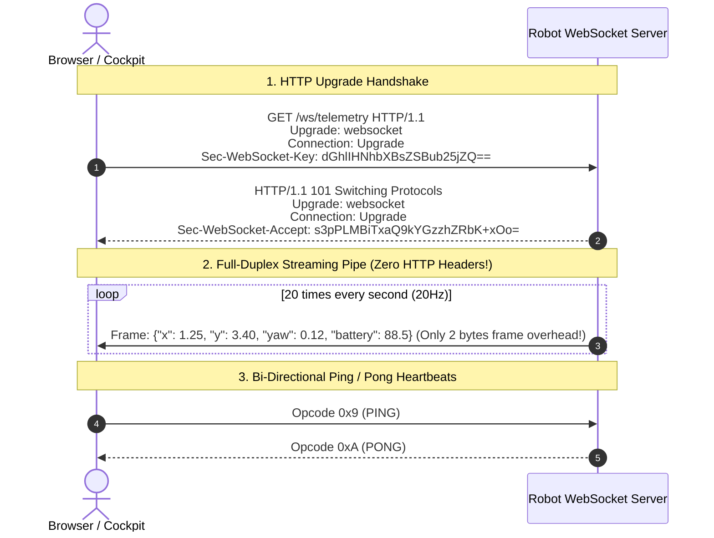

# Lesson 02: Real-Time WebSockets vs. HTTP Polling

In Lesson 01, we learned how the HTTP request-response cycle works for discrete operations like requesting status or dispatching a goal.

However, an Autonomous Mobile Robot is a dynamic, continuous physical system. Its wheels rotate at $50\,\text{Hz}$, odometry updates at $20\,\text{Hz}$, and LiDAR scans arrive at $10\,\text{Hz}$. When a remote operator watches the robot navigate on a map canvas, they need smooth, real-time telemetry updates.

In this lesson, you will learn why **HTTP Polling fails** for high-frequency robotics streaming and master **Real-Time WebSockets**.

---

## 1. Learning Objectives

By the end of this lesson, you will be able to:
1. Explain the latency, bandwidth, and connection exhaustion bottlenecks of HTTP polling.
2. Master the **WebSocket Protocol (RFC 6455)** lifecycle from HTTP handshake to full-duplex pipe.
3. Understand WebSocket framing: Text vs. Binary opcodes, ping/pong heartbeats, and close frames.
4. Compare network overhead between polling and WebSockets with mathematical proofs.
5. Implement a minimal Python WebSocket client and server connection.

---

## 2. The Bottleneck: Why HTTP Polling Fails for Robotics

When beginners want live robot updates, they typically write a frontend timer that polls the robot repeatedly:

```javascript
// ❌ NAIVE HTTP POLLING (20 times per second)
setInterval(async () => {
    const res = await fetch("http://192.168.1.100:8080/api/v1/telemetry");
    const data = await res.json();
    updateMap(data.x, data.y);
}, 50); // 50ms = 20Hz
```

```
HTTP Polling (20 requests every second):
Client ──[SYN/ACK TCP]──> Server ──[TLS Handshake]──> Server
Client ──[GET Request (850B headers)]──> Server
Server ──[HTTP 200 OK (300B headers + 120B payload)]──> Client
Client ──[FIN/ACK Close]──> Server
(Repeat this entire cycle 20 times every single second!)
```

### Three Devastating Consequences:
1. **Header Bloat:** Every HTTP/1.1 request sends $\approx 850\,\text{bytes}$ of redundant headers (User-Agent, Host, Cookie, Accept, Keep-Alive) just to transfer $120\,\text{bytes}$ of coordinate numbers ($88\%$ bandwidth waste!).
2. **TCP Socket Exhaustion:** Rapidly opening and closing TCP connections leaves hundreds of sockets in the `TIME_WAIT` state on the robot's Linux kernel, eventually exhausting ephemeral ports (`Errno 99: Cannot assign requested address`).
3. **Head-of-Line Latency Jitter:** If one HTTP request experiences a Wi-Fi packet drop, subsequent requests queue up, resulting in stuttering, laggy map visualization.

---

## 3. The Modern Solution: The WebSocket Protocol

**WebSocket (RFC 6455)** establishes a persistent, bi-directional, full-duplex TCP connection between client and robot over a single socket.



---

## 4. Mathematical Comparison: Polling vs. WebSockets

Let us calculate the bandwidth consumed by **1 operator dashboard** streaming robot pose at **$20\,\text{Hz}$** over a **$1\text{-hour}$** mission:

$$\text{Total Packets in 1 Hour} = 20\,\text{Hz} \times 3600\,\text{s} = 72{,}000\,\text{packets}$$

### Case A: HTTP Polling (20Hz)
$$\text{Per-Request Overhead} \approx 850\,\text{B (Req)} + 300\,\text{B (Resp Headers)} + 120\,\text{B (Payload)} = 1{,}270\,\text{bytes}$$
$$\text{Total Data Transferred} = 72{,}000 \times 1{,}270\,\text{B} = 91{,}440{,}000\,\text{bytes} \approx \mathbf{91.4\,\text{MB / hour}}$$

### Case B: WebSocket Stream (20Hz)
$$\text{Handshake Overhead} \approx 1{,}200\,\text{bytes (one-time only)}$$
$$\text{Per-Frame Overhead} = 2\,\text{bytes (Frame Header)} + 120\,\text{bytes (JSON Payload)} = 122\,\text{bytes}$$
$$\text{Total Data Transferred} = 1{,}200 + (72{,}000 \times 122\,\text{B}) = 8{,}785{,}200\,\text{bytes} \approx \mathbf{8.8\,\text{MB / hour}}$$

> [!TIP]
> **Performance Gain:**  
> Switching from HTTP polling to WebSockets reduces network bandwidth by over **$90\%$**, lowers latency from $\approx 45\,\text{ms}$ to $<5\,\text{ms}$, and completely prevents socket exhaustion on onboard robot computers!

---

## 5. WebSocket Framing & Opcode Specifications

Inside the TCP stream, WebSockets transmits discrete binary frames:

| Opcode (Hex) | Frame Type | Meaning in Robotics |
|---|---|---|
| `0x1` | **Text Frame** | UTF-8 encoded string (typically JSON telemetry: pose, battery, states). |
| `0x2` | **Binary Frame** | Raw binary payload (used for compressed JPEG camera frames or occupancy grid arrays). |
| `0x8` | **Connection Close** | Graceful shutdown handshake initiated by either client or robot. |
| `0x9` | **Ping** | Heartbeat probe sent by client or server to check network liveness. |
| `0xA` | **Pong** | Unsolicited or solicited heartbeat reply verifying active connection. |

---

## 6. Summary & Next Steps

In this lesson, you analyzed real-time communication protocols:
- Demonstrated why **HTTP polling** causes severe bandwidth bloat and socket exhaustion.
- Mastered the **WebSocket protocol lifecycle** and framing mechanisms.
- Proved mathematically that WebSockets deliver a **$90\%$ bandwidth reduction** with sub-$5\text{ms}$ latencies.

In **Lesson 03**, we will study **The Dual-Plane Architecture**: designing the boundary between this web layer and the real-time ROS 2 control plane!
