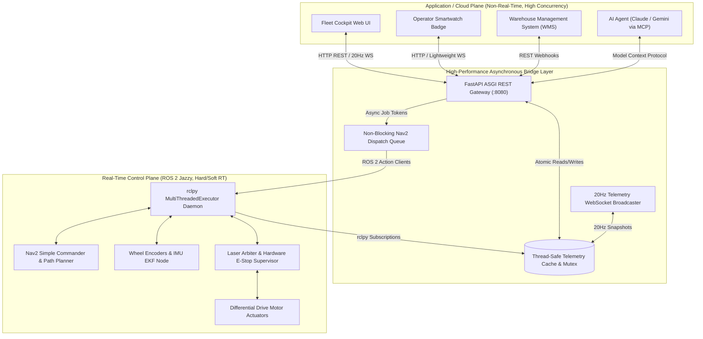

# Lesson 03: Enterprise System Architecture — The Dual-Plane Model

In Lessons 01 and 02, we established the communication foundations: HTTP for discrete transactional commands and WebSockets for high-frequency streaming.

Now, we address the architectural question that defines commercial robotics engineering: **Where does the web layer meet the robot's real-time controllers?**

In this lesson, you will learn the **Dual-Plane Architecture**, the industry-standard design pattern deployed in commercial fleets (including Amazon Robotics, OTTO Motors, and the **NavPro Mini Platform**).

---

## 1. Learning Objectives

By the end of this lesson, you will be able to:
1. Identify the architectural responsibilities of the **Real-Time Control Plane** vs. the **Application / Cloud Plane**.
2. Explain why exposing raw DDS sockets to web frontends violates safety and scalability principles.
3. Design the **High-Performance Bridge Layer** with thread isolation and mutex-protected memory caching.
4. Calculate end-to-end latency budgets from wheel encoder ticks to web browser canvas pixels.
5. Contrast custom API gateways with generic bridges like `rosbridge_suite`.

---

## 2. The Dual-Plane Architectural Blueprint

To guarantee robot safety and high web responsiveness, we divide the software stack into two isolated execution planes:



---

## 3. Comparing the Execution Planes

| Dimension | Real-Time Control Plane (ROS 2) | Application & Cloud Plane (Web Gateway) |
|---|---|---|
| **Primary Goal** | **Determinism & Safety:** Motors must stop if obstacles appear within $50\,\text{ms}$. | **Concurrency & Usability:** Handle multiple web clients, auth, and remote commands. |
| **Transport** | DDS UDP Multicast on `ROS_DOMAIN_ID`. | HTTP/1.1, HTTP/2, WebSockets over TCP on port `8080`. |
| **Latency Bounds** | Hard/Soft Real-Time ($<10\,\text{ms}$ bounded jitter). | Best-effort network latency ($10 - 200\,\text{ms}$). |
| **Fault Recovery** | Fail-safe: halt motors immediately if heartbeat drops. | Graceful degradation: reconnect, retry with exponential backoff. |
| **Threading** | OS threads pinned to CPU cores, high-priority executors. | Asynchronous event loop (`asyncio`, uvloop, ASGI). |

---

## 4. Why Generic Direct Bridges (`rosbridge_suite`) Fail in Production

Many academic projects rely on `rosbridge_suite` to connect web browsers to ROS 2. While suitable for quick lab tests, it creates severe vulnerabilities in commercial production:

1. **Schema Coupling:** Exposes raw ROS 2 message definitions (`geometry_msgs/msg/TwistStamped`) to frontend JavaScript. If you modify a ROS package, all frontend dashboards break!
2. **Security Vulnerability:** Any browser client with a WebSocket connection can publish directly to sensitive internal topics (like `/motor_raw_pwm` or `/reset_odom`).
3. **Bandwidth Explosion:** Transmitting raw point clouds or uncompressed laser scans over web sockets saturates Wi-Fi networks immediately.
4. **No Business Validation:** Cannot enforce coordinate bounds, rate limits, or user authorization tokens.

*By designing our own **FastAPI & WebSocket Gateway**, we enforce clean API schemas, user authentication, and physical safety constraints!*

---

## 5. End-to-End Latency Budget

Let us trace the time required for a wheel rotation to appear on the operator's web screen:

```
[Wheel Tick] ──1ms──> [ESP32 Micro-ROS] ──2ms──> [ROS 2 /odom Ingestion]
     ──0.1ms──> [Thread-Safe Cache Write] ──12ms (avg wait in 20Hz loop)──> 
     [WebSocket Broadcast] ──4ms (Local Wi-Fi)──> [Browser Render]
     ==============================================================
     TOTAL END-TO-END LATENCY: < 20 ms (Smooth 50-60 FPS UI experience!)
```

---

## 6. Summary & Next Steps

In this lesson, you mastered system architecture:
- Segregated software into the **Real-Time Control Plane** and **Application Plane**.
- Understood why **generic direct DDS bridges fail** in commercial deployments.
- Analyzed the end-to-end latency pipeline guaranteeing sub-$20\text{ms}$ telepresence.

In **Lesson 04**, we will implement the engine driving this bridge: **High-Concurrency ROS 2 Execution with MultiThreadedExecutor & Thread-Safe Caches**!
