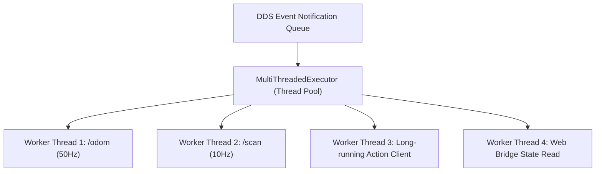

# Lesson 04: High-Concurrency ROS 2 Execution — MultiThreadedExecutor & Mutex Caches

In Lesson 03, we designed the Dual-Plane Architecture. To make this architecture function in code, we must solve a major concurrency problem in `rclpy`.

By default, ROS 2 Python nodes process callbacks sequentially on a single thread. When multiple high-frequency topics, services, and web bridge queries arrive simultaneously, a single-threaded executor causes starvation and severe latency spikes.

In this lesson, you will learn how to configure the `MultiThreadedExecutor`, manage callback groups, and implement thread-safe state sharing in Python.

---

## 1. Learning Objectives

By the end of this lesson, you will be able to:
1. Explain the architectural limitations of the default `SingleThreadedExecutor`.
2. Configure and deploy the `rclpy.executors.MultiThreadedExecutor` with managed worker thread pools.
3. Differentiate between `MutuallyExclusiveCallbackGroup` and `ReentrantCallbackGroup`.
4. Use Python `threading.Lock` to guarantee atomic state sharing between ROS 2 subscriber callbacks and web API endpoints.
5. Prevent common concurrency pitfalls: deadlocks, race conditions, and priority inversion.

---

## 2. SingleThreadedExecutor vs. MultiThreadedExecutor

When you run standard ROS 2 code using `rclpy.spin(node)`, ROS 2 uses a **`SingleThreadedExecutor`**:

```
SingleThreadedExecutor (Sequential FIFO Queue):
[ /odom callback ] ──> [ /scan callback ] ──> [ Long Service Call (Blocks 2s) ] ──> [ /battery STALLED! ]
```

If any callback performs a blocking operation (such as waiting for a service response, disk I/O, or mathematical calculations), **every other subscriber, timer, and action feedback callback is completely blocked**. For an AMR driving at $1.5\,\text{m/s}$, a $500\,\text{ms}$ delay in processing laser scans or odometry can lead to collision!

### The MultiThreadedExecutor

The `MultiThreadedExecutor` allocates a pool of worker OS threads (defaulting to the number of CPU cores). When an event occurs (a topic message arrives or a timer triggers), the executor assigns that callback to the next available worker thread:



---

## 3. Callback Groups in ROS 2

Even with a `MultiThreadedExecutor`, ROS 2 enforces safety rules regarding which callbacks can execute concurrently. This is governed by **Callback Groups**:

### 3.1 MutuallyExclusiveCallbackGroup (Default)
- **Rule:** Only **one** callback belonging to this group can execute at any given time.
- **Use Case:** Operations that mutate non-thread-safe internal state (e.g. updating a PID controller's integral accumulator).
- **Caveat:** If a timer in this group calls a ROS 2 service whose response callback is in the same group, your node will **deadlock** permanently!

### 3.2 ReentrantCallbackGroup
- **Rule:** Callbacks in this group can execute **concurrently** across multiple threads. Multiple instances of the *same* callback or different callbacks can run at the exact same moment.
- **Use Case:** High-throughput telemetry subscribers, web bridge read handlers, and non-blocking service clients.
- **Requirement:** You **must** protect all shared mutable variables with explicit thread synchronization locks (`threading.Lock`).

```python
from rclpy.callback_groups import MutuallyExclusiveCallbackGroup, ReentrantCallbackGroup

class DualPlaneBridgeNode(Node):
    def __init__(self):
        super().__init__('dual_plane_bridge_node')
        
        # Group for high-frequency concurrent sensor streams
        self.sensor_cb_group = ReentrantCallbackGroup()
        
        # Group for delicate actuator control commands
        self.motor_cb_group = MutuallyExclusiveCallbackGroup()
```

---

## 4. Thread-Safe State Sharing with `threading.Lock`

In Python, the Global Interpreter Lock (GIL) does *not* protect your application from race conditions when modifying complex data structures like dictionaries or object attributes across multiple threads.

To share telemetry between ROS 2 subscriber callbacks and the web API, we encapsulate shared state inside a thread-safe container using `threading.Lock`:

```python
import threading
from typing import Dict, Any

class ThreadSafeRobotState:
    """Thread-safe cache storing latest robot telemetry."""
    
    def __init__(self):
        self._lock = threading.Lock()
        self._data = {
            "x": 0.0,
            "y": 0.0,
            "yaw": 0.0,
            "linear_velocity": 0.0,
            "angular_velocity": 0.0,
            "battery_percentage": 100.0,
            "emergency_stop": False,
            "timestamp": 0.0
        }

    def update_pose_and_velocity(self, x: float, y: float, yaw: float, v: float, w: float):
        """Called by high-frequency ROS 2 /odom subscriber callback."""
        with self._lock:
            self._data["x"] = x
            self._data["y"] = y
            self._data["yaw"] = yaw
            self._data["linear_velocity"] = v
            self._data["angular_velocity"] = w

    def update_battery(self, percentage: float):
        """Called by /battery_state subscriber callback."""
        with self._lock:
            self._data["battery_percentage"] = percentage

    def get_snapshot(self) -> Dict[str, Any]:
        """Called by FastAPI REST / WebSocket threads to serialize state."""
        with self._lock:
            # Return a shallow copy so reading threads never mutate the active cache
            return self._data.copy()
```

---

## 5. Complete Implementation: MultiThreaded Background Worker

Here is the complete reference implementation showing how to launch `MultiThreadedExecutor` inside an isolated Python background thread:

```python
import threading
import time
import math
import rclpy
from rclpy.node import Node
from rclpy.executors import MultiThreadedExecutor
from rclpy.callback_groups import ReentrantCallbackGroup
from nav_msgs.msg import Odometry
from sensor_msgs.msg import BatteryState

class TelemetryCollectorNode(Node):
    def __init__(self, state_cache: ThreadSafeRobotState):
        super().__init__('telemetry_collector_node')
        self.state_cache = state_cache
        self.reentrant_group = ReentrantCallbackGroup()

        # Ingest odometry at 20-50Hz
        self.odom_sub = self.create_subscription(
            Odometry,
            '/odom',
            self.odom_callback,
            10,
            callback_group=self.reentrant_group
        )

        # Ingest battery state at 1Hz
        self.battery_sub = self.create_subscription(
            BatteryState,
            '/battery_state',
            self.battery_callback,
            10,
            callback_group=self.reentrant_group
        )
        self.get_logger().info("TelemetryCollectorNode initialized with MultiThreadedExecutor.")

    def odom_callback(self, msg: Odometry):
        x = msg.pose.pose.position.x
        y = msg.pose.pose.position.y
        
        # Quaternion to Yaw calculation
        q = msg.pose.pose.orientation
        siny_cosp = 2.0 * (q.w * q.z + q.x * q.y)
        cosy_cosp = 1.0 - 2.0 * (q.y * q.y + q.z * q.z)
        yaw = math.atan2(siny_cosp, cosy_cosp)
        
        lin_v = msg.twist.twist.linear.x
        ang_w = msg.twist.twist.angular.z

        self.state_cache.update_pose_and_velocity(x, y, yaw, lin_v, ang_w)

    def battery_callback(self, msg: BatteryState):
        pct = msg.percentage * 100.0 if msg.percentage <= 1.0 else msg.percentage
        self.state_cache.update_battery(pct)


def start_ros2_background_daemon(state_cache: ThreadSafeRobotState) -> threading.Thread:
    """Spawns rclpy MultiThreadedExecutor in an isolated OS daemon thread."""
    def worker():
        rclpy.init()
        node = TelemetryCollectorNode(state_cache)
        executor = MultiThreadedExecutor(num_threads=4)
        executor.add_node(node)
        try:
            executor.spin()
        finally:
            node.destroy_node()
            rclpy.shutdown()

    t = threading.Thread(target=worker, daemon=True, name="ROS2-Executor-Worker")
    t.start()
    return t
```

---

## 6. Summary & Next Steps

In this lesson, you mastered concurrent ROS 2 execution:
- Deployed the **`MultiThreadedExecutor`** to eliminate single-threaded callback starvation.
- Used **`ReentrantCallbackGroup`** for concurrent sensor ingestion.
- Implemented **`threading.Lock`** mutexes to guarantee thread-safe cache updates.

In **Lesson 05**, we will connect this thread-safe state cache to **FastAPI**, creating our production REST endpoints and Pydantic validation schemas!
