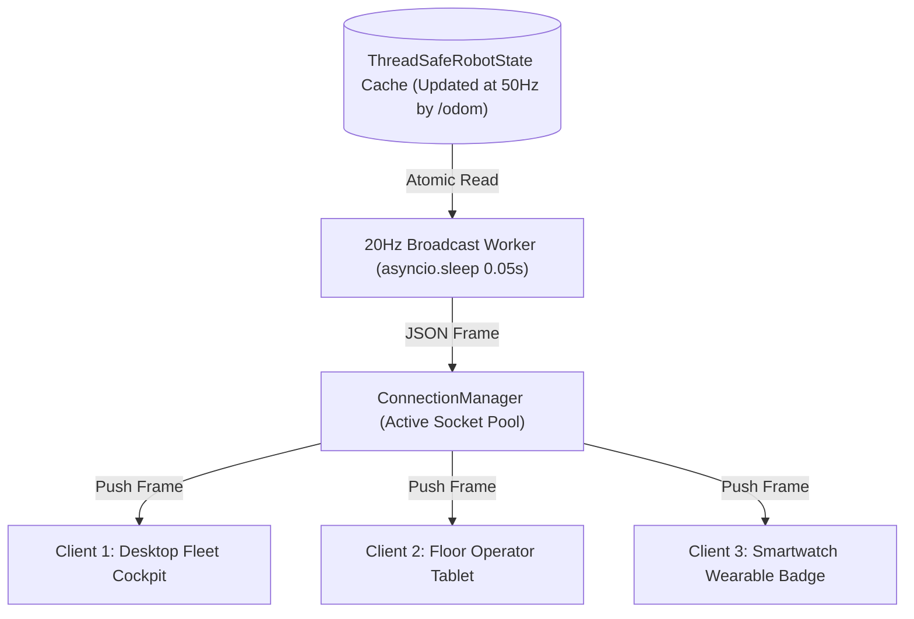

# Lesson 06: High-Frequency 20Hz WebSocket Telemetry Broadcaster

In Lesson 05, we built the REST endpoints. Now, we implement the real-time engine: the **20Hz WebSocket Broadcaster**.

In an autonomous warehouse, multiple client devices (the supervisor's desktop cockpit, floor tablets, and wearable smartwatch badges) must track the robot's physical movement simultaneously.

In this lesson, you will build a scalable `ConnectionManager` and an `asyncio` 20Hz broadcast worker that streams odometry snapshots to all connected clients.

---

## 1. Learning Objectives

By the end of this lesson, you will be able to:
1. Implement an asynchronous `ConnectionManager` handling multiple concurrent client sockets.
2. Schedule a high-precision 20Hz ($50\,\text{ms}$) broadcast loop using Python `asyncio`.
3. Ingest mutex-protected cache snapshots and serialize clean telemetry JSON frames.
4. Detect disconnected clients and prune dead sockets to prevent memory leaks.
5. Verify live streaming using terminal tools (`websocat`) and browser JavaScript.

---

## 2. Multi-Client WebSocket Architecture



---

## 3. Implementing the `ConnectionManager`

```python
import asyncio
import json
import logging
from typing import Set, Dict, Any
from fastapi import WebSocket, WebSocketDisconnect

logger = logging.getLogger("WebSocketBroadcaster")


class ConnectionManager:
    """Maintains active WebSocket clients and broadcasts telemetry frames."""

    def __init__(self):
        self.active_connections: Set[WebSocket] = set()
        self._lock = asyncio.Lock()

    async def connect(self, websocket: WebSocket):
        """Accepts and registers incoming client socket."""
        await websocket.accept()
        async with self._lock:
            self.active_connections.add(websocket)
        logger.info(f"WebSocket client connected. Total clients: {len(self.active_connections)}")

    async def disconnect(self, websocket: WebSocket):
        """Removes disconnected socket."""
        async with self._lock:
            self.active_connections.discard(websocket)
        logger.info(f"WebSocket client removed. Remaining clients: {len(self.active_connections)}")

    async def broadcast_json(self, frame: Dict[str, Any]):
        """Pushes JSON payload to all active clients concurrently."""
        if not self.active_connections:
            return

        payload_str = json.dumps(frame)
        stale_clients = []

        async with self._lock:
            clients_snapshot = list(self.active_connections)

        for ws in clients_snapshot:
            try:
                await ws.send_text(payload_str)
            except Exception:
                stale_clients.append(ws)

        if stale_clients:
            async with self._lock:
                for ws in stale_clients:
                    self.active_connections.discard(ws)
            logger.warning(f"Pruned {len(stale_clients)} dead WebSocket sockets.")
```

---

## 4. Building the 20Hz Broadcast Loop

Inside FastAPI's lifespan, we spawn the background broadcaster:

```python
ws_manager = ConnectionManager()


async def telemetry_broadcast_worker():
    """Extracts state every 50ms (20Hz) and broadcasts to all web clients."""
    logger.info("20Hz Telemetry Broadcast Worker started.")
    while True:
        try:
            # 1. Fetch latest snapshot from thread-safe cache
            snapshot = robot_state.get_snapshot()

            # 2. Construct clean JSON frame
            telemetry_frame = {
                "type": "TELEMETRY_FRAME",
                "robot_id": "navpro-mini-amr",
                "x": round(snapshot["x"], 3),
                "y": round(snapshot["y"], 3),
                "yaw": round(snapshot["yaw"], 3),
                "linear_v": round(snapshot["linear_velocity"], 2),
                "angular_w": round(snapshot["angular_velocity"], 2),
                "battery": round(snapshot["battery_percentage"], 1),
                "estop": snapshot["emergency_stop"],
                "timestamp": round(snapshot["timestamp"], 3)
            }

            # 3. Broadcast to all connected dashboards
            await ws_manager.broadcast_json(telemetry_frame)

        except Exception as e:
            logger.error(f"Error in telemetry broadcast worker: {e}")

        # Sleep exactly 50ms (20Hz)
        await asyncio.sleep(0.05)


@app.websocket("/ws/telemetry")
async def websocket_telemetry_endpoint(websocket: WebSocket):
    """WebSocket route accessed by Cockpit UI and Smartwatch."""
    await ws_manager.connect(websocket)
    try:
        while True:
            # Keep socket open and listen for ping heartbeats
            client_msg = await websocket.receive_text()
            if client_msg == "PING":
                await websocket.send_text('{"type": "PONG"}')
    except WebSocketDisconnect:
        await ws_manager.disconnect(websocket)
    except Exception as e:
        logger.warning(f"Socket dropped: {e}")
        await ws_manager.disconnect(websocket)
```

---

## 5. Testing with `websocat` in Terminal

You can test this streaming endpoint from the command line using the `websocat` utility:

```bash
websocat ws://localhost:8080/ws/telemetry
```

*Expected Terminal Stream (updating at 20 frames per second):*
```json
{"type": "TELEMETRY_FRAME", "robot_id": "navpro-mini-amr", "x": 0.0, "y": 0.0, "yaw": 0.0, "linear_v": 0.0, "angular_w": 0.0, "battery": 94.2, "estop": false, "timestamp": 1728812400.05}
{"type": "TELEMETRY_FRAME", "robot_id": "navpro-mini-amr", "x": 0.02, "y": 0.0, "yaw": 0.01, "linear_v": 0.2, "angular_w": 0.05, "battery": 94.2, "estop": false, "timestamp": 1728812400.10}
{"type": "TELEMETRY_FRAME", "robot_id": "navpro-mini-amr", "x": 0.05, "y": 0.01, "yaw": 0.02, "linear_v": 0.35, "angular_w": 0.05, "battery": 94.1, "estop": false, "timestamp": 1728812400.15}
```

---

## 6. Summary & Next Steps

In this lesson, you built real-time streaming:
- Constructed a thread-safe `ConnectionManager` supporting multiple clients.
- Scheduled an asynchronous 20Hz broadcast loop.
- Verified smooth, uninterrupted streaming with automatic dead-client pruning.

In **Lesson 07**, we tackle long-running tasks: **Non-Blocking Nav2 Action Dispatching & HTTP 202 Accepted**!
