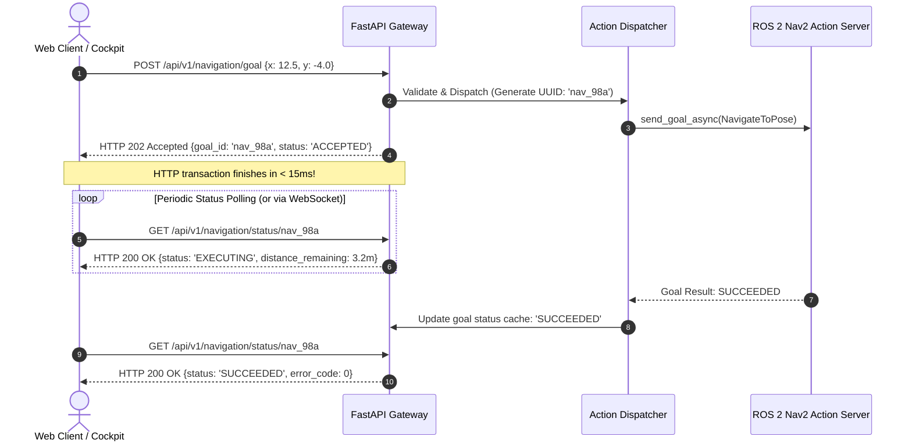

# Lesson 07: Non-Blocking Nav2 Action Dispatching — HTTP 202 Accepted

In Lesson 06, we built the real-time streaming pipe. Now, we tackle long-running physical tasks: **Autonomous Waypoint Navigation**.

When an AMR drives across a warehouse, the navigation maneuver may take **$15$ to $90$ seconds**. If an HTTP endpoint (`POST /api/v1/navigation/goal`) blocks waiting for the robot to arrive:
1. The web client's request will time out with an `HTTP 504 Gateway Timeout`.
2. The web connection remains locked, exhausting server socket pools.
3. The client cannot send cancellation requests or monitor live progress.

In this lesson, you will learn the **Asynchronous Action Dispatch Pattern**, mapping ROS 2 Actions into non-blocking `HTTP 202 Accepted` workflows.

---

## 1. Learning Objectives

By the end of this lesson, you will be able to:
1. Explain why synchronous HTTP request-response fails for physical robotics navigation.
2. Implement the **HTTP 202 Accepted** pattern with tracking `goal_id` tokens.
3. Wrap `rclpy.action.ActionClient` for `nav2_msgs/action/NavigateToPose` inside async Python routines.
4. Build a state tracker for active navigation goals (`ACCEPTED`, `EXECUTING`, `SUCCEEDED`, `FAILED`, `CANCELED`).
5. Implement safe cancellation endpoints (`POST /api/v1/navigation/cancel/{goal_id}`).

---

## 2. The Asynchronous Action Dispatch Pattern

Instead of blocking the HTTP connection, we decouple **goal initiation** from **goal monitoring**:



---

## 3. Implementing the Goal Registry

We maintain an in-memory registry tracking the lifecycle of all submitted navigation jobs:

```python
import uuid
import time
from enum import Enum
from typing import Dict, Any, Optional
from pydantic import BaseModel


class GoalState(str, Enum):
    ACCEPTED = "ACCEPTED"
    EXECUTING = "EXECUTING"
    SUCCEEDED = "SUCCEEDED"
    FAILED = "FAILED"
    CANCELED = "CANCELED"


class NavigationJob(BaseModel):
    goal_id: str
    target_x: float
    target_y: float
    target_yaw: float
    status: GoalState
    created_at: float
    completed_at: Optional[float] = None
    error_message: Optional[str] = None


class GoalRegistry:
    """Thread-safe registry tracking active and completed navigation tasks."""

    def __init__(self):
        self._jobs: Dict[str, NavigationJob] = {}

    def create_job(self, x: float, y: float, yaw: float) -> str:
        goal_id = f"nav_{uuid.uuid4().hex[:8]}"
        job = NavigationJob(
            goal_id=goal_id,
            target_x=x,
            target_y=y,
            target_yaw=yaw,
            status=GoalState.ACCEPTED,
            created_at=time.time()
        )
        self._jobs[goal_id] = job
        return goal_id

    def update_status(self, goal_id: str, status: GoalState, error: Optional[str] = None):
        if goal_id in self._jobs:
            self._jobs[goal_id].status = status
            if status in (GoalState.SUCCEEDED, GoalState.FAILED, GoalState.CANCELED):
                self._jobs[goal_id].completed_at = time.time()
            if error:
                self._jobs[goal_id].error_message = error

    def get_job(self, goal_id: str) -> Optional[NavigationJob]:
        return self._jobs.get(goal_id)
```

---

## 4. Wrapping the Nav2 Action Client

```python
from rclpy.action import ActionClient
from nav2_msgs.action import NavigateToPose
from geometry_msgs.msg import PoseStamped
import math

class Nav2BridgeNode(Node):
    def __init__(self, registry: GoalRegistry):
        super().__init__('nav2_bridge_node')
        self.registry = registry
        self.action_client = ActionClient(self, NavigateToPose, 'navigate_to_pose')
        self.active_goal_handle = None

    def dispatch_navigation_goal(self, goal_id: str, x: float, y: float, yaw: float):
        """Asynchronously dispatches goal to Nav2 without blocking."""
        if not self.action_client.wait_for_server(timeout_sec=2.0):
            self.registry.update_status(goal_id, GoalState.FAILED, "Nav2 Action Server not available")
            return

        goal_msg = NavigateToPose.Goal()
        goal_msg.pose.header.frame_id = 'map'
        goal_msg.pose.header.stamp = self.get_clock().now().to_msg()
        goal_msg.pose.pose.position.x = float(x)
        goal_msg.pose.pose.position.y = float(y)
        
        # Quaternion calculation
        goal_msg.pose.pose.orientation.z = math.sin(yaw / 2.0)
        goal_msg.pose.pose.orientation.w = math.cos(yaw / 2.0)

        # Send goal asynchronously
        send_future = self.action_client.send_goal_async(goal_msg)
        send_future.add_done_callback(lambda future: self._goal_response_callback(future, goal_id))

    def _goal_response_callback(self, future, goal_id: str):
        goal_handle = future.result()
        if not goal_handle.accepted:
            self.registry.update_status(goal_id, GoalState.FAILED, "Nav2 rejected navigation goal")
            return

        self.active_goal_handle = goal_handle
        self.registry.update_status(goal_id, GoalState.EXECUTING)
        
        result_future = goal_handle.get_result_async()
        result_future.add_done_callback(lambda res_fut: self._goal_result_callback(res_fut, goal_id))

    def _goal_result_callback(self, future, goal_id: str):
        result = future.result()
        # ROS 2 GoalStatus: 4 = SUCCEEDED, 5 = CANCELED
        if result.status == 4:
            self.registry.update_status(goal_id, GoalState.SUCCEEDED)
        elif result.status == 5:
            self.registry.update_status(goal_id, GoalState.CANCELED)
        else:
            self.registry.update_status(goal_id, GoalState.FAILED, f"Nav2 returned status code: {result.status}")
        self.active_goal_handle = None

    def cancel_active_goal(self, goal_id: str) -> bool:
        if self.active_goal_handle:
            self.active_goal_handle.cancel_goal_async()
            self.registry.update_status(goal_id, GoalState.CANCELED)
            return True
        return False
```

---

## 5. Exposing Endpoints in FastAPI

```python
@app.post("/api/v1/navigation/goal", status_code=status.HTTP_202_ACCEPTED)
async def dispatch_goal(payload: NavigationGoalPayload):
    """Submits a navigation goal and returns HTTP 202 Accepted immediately."""
    goal_id = goal_registry.create_job(payload.x, payload.y, payload.yaw)
    nav2_node.dispatch_navigation_goal(goal_id, payload.x, payload.y, payload.yaw)

    return {
        "status": "ACCEPTED",
        "goal_id": goal_id,
        "message": "Navigation goal accepted and dispatched to Nav2.",
        "status_url": f"/api/v1/navigation/status/{goal_id}"
    }


@app.get("/api/v1/navigation/status/{goal_id}")
async def get_goal_status(goal_id: str):
    """Retrieves current execution status of a navigation job."""
    job = goal_registry.get_job(goal_id)
    if not job:
        raise HTTPException(status_code=404, detail="Navigation goal ID not found.")
    return job


@app.post("/api/v1/navigation/cancel/{goal_id}")
async def cancel_goal(goal_id: str):
    """Cancels an in-progress navigation goal."""
    success = nav2_node.cancel_active_goal(goal_id)
    if not success:
        raise HTTPException(status_code=400, detail="Unable to cancel goal (not active or completed).")
    return {"status": "CANCEL_REQUESTED", "goal_id": goal_id}
```

---

## 6. Summary & Next Steps

In this lesson, you mastered non-blocking action handling:
- Replaced fragile synchronous HTTP requests with the **HTTP 202 Accepted** pattern.
- Tracked full navigation lifecycles using unique `goal_id` identifiers.
- Implemented cancellation hooks to safely abort autonomous motion in real time.

In **Lesson 08**, you will combine everything built in Day 1 into our **Day 1 Capstone Project: The Production NavPro API Gateway**!
