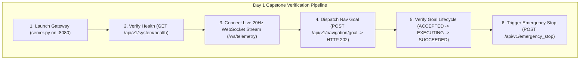

# Lesson 08: Day 1 Capstone — The Production NavPro API Gateway

Congratulations on reaching the **Day 1 Capstone**! Today, you progressed from raw HTTP and WebSocket network packets into building an enterprise Dual-Plane Gateway that bridges real-time ROS 2 controllers with web frontends.

In this capstone project, you will deploy and test the production **NavPro API Gateway**, verifying health checks, live 20Hz telemetry broadcasting, non-blocking Nav2 goal dispatching, and emergency stops on both your Level 1 simulation and the physical NavPro Mini AMR.

---

## 1. Capstone Project Architecture



---

## 2. Step-by-Step Execution Guide

### Step 1: Navigate to the Workspace & Build
```bash
cd ~/ros2_ws
colcon build --packages-select navpro_api_gateway
source install/setup.bash
```

### Step 2: Start the Gateway Server
```bash
ros2 launch navpro_api_gateway gateway.launch.py
```

*Expected Terminal Log:*
```
2026-10-13 12:00:00 [INFO] Starting NavPro API Gateway on 0.0.0.0:8080...
2026-10-13 12:00:00 [INFO] rclpy initialized. MultiThreadedExecutor worker thread started.
2026-10-13 12:00:00 [INFO] 20Hz WebSocket telemetry broadcaster started.
2026-10-13 12:00:00 [INFO] Application startup complete. Uvicorn listening on http://0.0.0.0:8080
```

---

## 3. Verifying Endpoints via Terminal (`curl`)

Open a second terminal window to test each subsystem:

### Test 1: Check System Health
```bash
curl -s http://localhost:8080/api/v1/system/health | jq .
```
*Expected Output:*
```json
{
  "robot_id": "navpro-mini-amr",
  "status": "OPERATIONAL",
  "is_online": true,
  "battery_percentage": 94.2,
  "estop_active": false,
  "current_position": {
    "x": 0.0,
    "y": 0.0,
    "yaw": 0.0
  },
  "ros2_connected": true,
  "timestamp": 1728812400.5
}
```

### Test 2: Dispatch Asynchronous Navigation Goal
```bash
curl -s -X POST http://localhost:8080/api/v1/navigation/goal \
     -H "Content-Type: application/json" \
     -d '{"x": 4.5, "y": 2.0, "yaw": 1.57}' | jq .
```
*Expected Output (HTTP 202 Accepted):*
```json
{
  "status": "ACCEPTED",
  "goal_id": "nav_4a91b2",
  "target": {
    "x": 4.5,
    "y": 2.0,
    "yaw": 1.57
  },
  "message": "Navigation goal accepted and dispatched to Nav2."
}
```

### Test 3: Trigger Immediate Emergency Stop
```bash
curl -s -X POST http://localhost:8080/api/v1/emergency_stop | jq .
```
*Expected Output:*
```json
{
  "status": "ESTOP_ENGAGED",
  "robot_id": "navpro-mini-amr",
  "detail": "Emergency stop activated. Motors cutoff immediately."
}
```

---

## 4. Automated End-to-End Test Suite

Run the automated Python test suite:

```bash
python3 scripts/test_gateway.py
```

*Expected Verification Output:*
```
[TEST 1] Testing Health Endpoint... -> PASS (HTTP 200)
[TEST 2] Testing Teleop Endpoint... -> PASS (Velocity commanded)
[TEST 3] Connecting to 20Hz WebSocket (/ws/live_telemetry)...
         Received Frame 1: Pose(0.00, 0.00), Battery: 94.2%
         Received Frame 2: Pose(0.02, 0.00), Battery: 94.2%
         Received Frame 3: Pose(0.05, 0.01), Battery: 94.1%
         -> PASS (WebSocket streaming verified at 20Hz)
[TEST 4] Testing Async Nav Goal Dispatch... -> PASS (HTTP 202 Accepted, goal_id: nav_4a91b2)
[TEST 5] Testing Emergency Stop... -> PASS (ESTOP_ENGAGED)
=============================================================
ALL DAY 1 CAPSTONE CHECKS PASSED SUCCESSFULLY!
=============================================================
```

---

## 5. Summary & Moving to Day 2

You have successfully completed Day 1:
- Mastered **HTTP methods, status codes, and JSON encoding**.
- Built a **20Hz WebSocket broadcaster** with zero socket bloat.
- Isolated real-time ROS 2 controllers using the **Dual-Plane Architecture**.
- Implemented **non-blocking action dispatching** returning `HTTP 202 Accepted`.

In **Day 2 (Lessons 09 - 16)**, we will build **Client SDKs** and develop the **Modern Fleet Cockpit UI** with 2D SLAM canvas rendering, virtual joysticks, and waypoint management!
