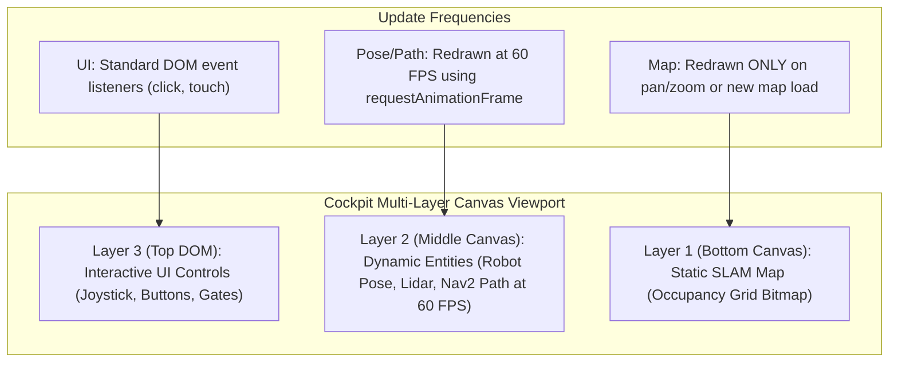

# Lesson 10: Modern Fleet Cockpit UI Architecture — Multi-Layer Canvas & Coordinates

In Lesson 09, we built our Client SDKs. Now, we begin constructing the frontend operator surface: **The Modern Fleet Cockpit GUI**.

When building robotics dashboards, the most common engineering mistake is treating a robotics map like a standard web page. If you attempt to render a $2000 \times 2000$ SLAM occupancy grid inside an HTML `` tag or redraw the entire DOM at $20\,\text{Hz}$, the browser tab will freeze and drop frames.

In this lesson, you will learn the **Multi-Layer Canvas Architecture** and master the mathematical transformation between **ROS Metric Frames** and **HTML5 Screen Pixels**.

---

## 1. Learning Objectives

By the end of this lesson, you will be able to:
1. Explain the performance advantages of Multi-Layer Canvas Architecture over single-layer DOM rendering.
2. Differentiate between the **ROS 2 Metric Coordinate Frame** (Right-handed, $+X$ Forward, $+Y$ Left) and the **HTML5 Canvas Frame** ($+X$ Right, $+Y$ Down).
3. Derive and implement the mathematical transformation formula mapping world meters to screen pixels.
4. Implement pan and zoom viewport navigation (scaling and translation offsets).
5. Structure a modern HTML5/CSS3 robotics cockpit layout.

---

## 2. Multi-Layer Canvas Architecture

In high-performance cockpits (like RViz, Foxglove Studio, and the **NavPro Cockpit**), the viewport is split into three independent visual layers:



- **Bottom Canvas (Layer 1):** Renders the static SLAM grid. Decoded once into an off-screen bitmap.
- **Middle Canvas (Layer 2):** Cleared and redrawn at 60 FPS. Renders the robot marker, heading vector, footprint, and Nav2 planned path.
- **Top DOM (Layer 3):** Standard HTML/CSS buttons, virtual joysticks, and modal dialogs.

---

## 3. The Coordinate Transformation Problem

ROS 2 coordinate frames (defined by REP-105) follow standard mathematical conventions:
- $+X$ points **forward** (East).
- $+Y$ points **left** (North).
- Yaw angle $\theta$ rotates **counter-clockwise**.
- Units are strictly in **meters**.

HTML5 Canvas uses a computer graphics coordinate frame:
- Origin $(0, 0)$ is at the **top-left corner**.
- $+X$ points **right**.
- $+Y$ points **downward**.
- Yaw angle $\theta$ rotates **clockwise**.
- Units are strictly in **pixels**.

```
    ROS 2 World Frame (Meters):          Canvas Screen Frame (Pixels):
            +Y (Left / North)                     (0, 0) ───────> +X (Right)
                 ▲                                  │
                 │                                  │
                 └──────> +X (Forward)              ▼ +Y (Down)
```

---

## 4. The World-to-Screen Mathematical Formula

To convert any point $(x_{\text{world}}, y_{\text{world}})$ into screen pixels $(x_{\text{screen}}, y_{\text{screen}})$:

$$x_{\text{screen}} = \text{pan}_x + (x_{\text{world}} - \text{origin}_x) \cdot \text{scale}$$

$$y_{\text{screen}} = \text{pan}_y - (y_{\text{world}} - \text{origin}_y) \cdot \text{scale}$$

Where:
- $\text{scale}$ is the zoom factor in **pixels per meter** (e.g. $25\,\text{px/m}$).
- $\text{origin}_x, \text{origin}_y$ is the map origin offset in meters.
- $\text{pan}_x, \text{pan}_y$ is the canvas pan offset in pixels (usually canvas center: $\text{width}/2, \text{height}/2$).
- Notice the **minus sign ($-$)** in $y_{\text{screen}}$: this inverts the vertical axis so $+Y$ points up!

---

## 5. Implementing the Coordinate Transformer in JavaScript

```javascript
class CoordinateTransformer {
    constructor(canvasWidth, canvasHeight) {
        this.scale = 25.0; // 25 pixels per meter
        this.panX = canvasWidth / 2;
        this.panY = canvasHeight / 2;
        this.mapOriginX = 0.0;
        this.mapOriginY = 0.0;
    }

    worldToScreen(worldX, worldY) {
        const screenX = this.panX + (worldX - this.mapOriginX) * this.scale;
        const screenY = this.panY - (worldY - this.mapOriginY) * this.scale;
        return { x: screenX, y: screenY };
    }

    screenToWorld(screenX, screenY) {
        const worldX = ((screenX - this.panX) / this.scale) + this.mapOriginX;
        const worldY = -((screenY - this.panY) / this.scale) + this.mapOriginY;
        return { x: worldX, y: worldY };
    }

    zoom(delta, cursorX, cursorY) {
        const factor = delta > 0 ? 1.15 : 0.85;
        this.scale = Math.max(5.0, Math.min(200.0, this.scale * factor));
    }

    pan(dx, dy) {
        this.panX += dx;
        this.panY += dy;
    }
}
```

---

## 6. Summary & Next Steps

In this lesson, you designed the Cockpit architecture:
- Adopted the **Multi-Layer Canvas Architecture** to preserve 60 FPS performance.
- Mastered the mathematical conversion between **ROS metric space** and **Canvas screen pixels**.
- Built the `CoordinateTransformer` class supporting pan and zoom.

In **Lesson 11**, we will decode and render the **2D SLAM Occupancy Grid Map** on Canvas Layer 1!
