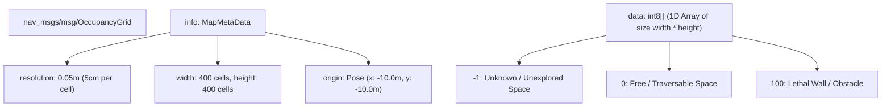

# Lesson 11: Rendering the 2D SLAM Map — Occupancy Grids on HTML5 Canvas

In Lesson 10, we implemented coordinate transforms. Now, we will render the physical foundation of autonomous navigation: **The 2D SLAM Occupancy Grid Map**.

In ROS 2, mapping packages like `slam_toolbox` and `cartographer` publish maps as `nav_msgs/msg/OccupancyGrid`. To visualize this map in a browser cockpit, we must decode this 1D array of probability numbers into RGBA pixels and render them on an off-screen canvas.

In this lesson, you will master the structure of ROS 2 Occupancy Grids and build an efficient JavaScript renderer.

---

## 1. Learning Objectives

By the end of this lesson, you will be able to:
1. Deconstruct the ROS 2 `nav_msgs/msg/OccupancyGrid` message: `resolution`, `width`, `height`, `origin`, and `data`.
2. Map occupancy values ($-1$, $0$, $100$) into visual color palettes (Unknown, Free space, Lethal obstacles).
3. Convert a 1D row-major array into an HTML5 `ImageData` RGBA buffer (`Uint8ClampedArray`).
4. Cache decoded maps onto an off-screen canvas to eliminate redrawing lag.
5. Render the scaled, aligned map onto the cockpit screen.

---

## 2. Anatomy of an Occupancy Grid

In ROS 2, an `OccupancyGrid` represents 2D space as a discrete grid of square cells:



### Color Palette Mapping
| Value in Grid | Cell State | Hex Color | Visual Appearance |
|---|---|---|---|
| **`-1`** | **Unknown Space** | `#94a3b8` | Medium gray background. |
| **`0`** | **Free Space** | `#ffffff` | Pure white (robot can drive here). |
| **`1` to `99`** | **Dynamic Gradient** | `#e2e8f0` &rarr; `#334155` | Gradual grayscale based on occupancy probability. |
| **`100`** | **Lethal Obstacle** | `#0f172a` | Deep black/slate (walls, furniture, columns). |

---

## 3. Decoding 1D Row-Major Data into RGBA Pixels

The `data` array is serialized in **row-major order**: row 0 (bottom-left) to row $H-1$ (top-right).

HTML5 Canvas expects an `ImageData` array where every cell occupies **4 contiguous bytes: [Red, Green, Blue, Alpha]**:

```javascript
function decodeOccupancyGridToImageData(grid) {
    const width = grid.width;
    const height = grid.height;
    const data = grid.data; // 1D array of numbers [-1, 100]

    // Create an off-screen RGBA image buffer (4 bytes per cell)
    const imgData = new ImageData(width, height);
    const pixels = imgData.data;

    for (let row = 0; row < height; row++) {
        for (let col = 0; col < width; col++) {
            // ROS 2 row 0 is at bottom; Canvas row 0 is at top -> Invert Y row index
            const rosIndex = row * width + col;
            const canvasIndex = ((height - 1 - row) * width + col) * 4;

            const val = data[rosIndex];

            if (val === -1) {
                // Unknown space: Slate Gray (#94a3b8)
                pixels[canvasIndex] = 148;     // R
                pixels[canvasIndex + 1] = 163; // G
                pixels[canvasIndex + 2] = 184; // B
                pixels[canvasIndex + 3] = 255; // Alpha
            } else if (val === 0) {
                // Free space: White (#ffffff)
                pixels[canvasIndex] = 255;
                pixels[canvasIndex + 1] = 255;
                pixels[canvasIndex + 2] = 255;
                pixels[canvasIndex + 3] = 255;
            } else {
                // Obstacle (val > 0): Dark Slate (#0f172a)
                pixels[canvasIndex] = 15;
                pixels[canvasIndex + 1] = 23;
                pixels[canvasIndex + 2] = 42;
                pixels[canvasIndex + 3] = 255;
            }
        }
    }

    return imgData;
}
```

---

## 4. Off-Screen Canvas Caching Pattern

Once decoded, we draw the `ImageData` onto a dedicated **off-screen canvas**. When the operator pans or zooms, the browser simply blits the pre-rendered image buffer at hardware-accelerated speeds:

```javascript
class MapLayerRenderer {
    constructor() {
        this.offscreenCanvas = document.createElement("canvas");
        this.offscreenCtx = this.offscreenCanvas.getContext("2d");
        this.isLoaded = false;
        this.gridInfo = null;
    }

    loadGrid(gridData) {
        this.gridInfo = gridData.info;
        this.offscreenCanvas.width = this.gridInfo.width;
        this.offscreenCanvas.height = this.gridInfo.height;

        const imgData = decodeOccupancyGridToImageData(gridData);
        this.offscreenCtx.putImageData(imgData, 0, 0);
        this.isLoaded = true;
    }

    render(ctx, transformer) {
        if (!this.isLoaded) return;

        // Calculate screen bounding box for the map image
        const resolution = this.gridInfo.resolution; // e.g. 0.05 m/cell
        const originX = this.gridInfo.origin.x;
        const originY = this.gridInfo.origin.y;

        // Lower-left corner in screen coordinates
        const pt = transformer.worldToScreen(originX, originY);
        
        const renderWidth = this.gridInfo.width * resolution * transformer.scale;
        const renderHeight = this.gridInfo.height * resolution * transformer.scale;

        // Draw cached bitmap
        ctx.imageSmoothingEnabled = false; // Keep sharp crisp pixelated walls
        ctx.drawImage(this.offscreenCanvas, pt.x, pt.y - renderHeight, renderWidth, renderHeight);
    }
}
```

---

## 5. Summary & Next Steps

In this lesson, you mastered 2D SLAM map rendering:
- Decoded the ROS 2 **`OccupancyGrid` structure**.
- Mapped $-1, 0, 100$ into clean, modern color palettes.
- Used **off-screen canvas caching** to render gigabyte grids with zero stutter.

In **Lesson 12**, we will build Layer 2: **Rendering the Live Robot Pose, Heading & Planned Nav2 Paths at 60 FPS**!
