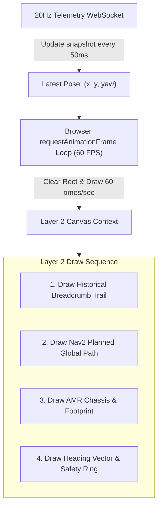

# Lesson 12: Live Robot Pose & Trajectory Rendering at 60 FPS

In Lesson 11, we decoded and rendered the static SLAM Occupancy Grid on Canvas Layer 1.

Now, we build the dynamic entity layer: **Canvas Layer 2**. This layer runs a smooth $60\,\text{FPS}$ render loop (`requestAnimationFrame`), updating the robot's physical position, heading vector, circular chassis footprint, and the planned Nav2 global trajectory.

---

## 1. Learning Objectives

By the end of this lesson, you will be able to:
1. Implement a 60 FPS rendering loop using `requestAnimationFrame`.
2. Clear and redraw dynamic entities without affecting the cached map underneath.
3. Draw metric robot features: AMR circular footprint, orientation pointer, and safety inflation buffer.
4. Render Nav2 global path trajectories (`nav_msgs/msg/Path`) as styled spline paths.
5. Maintain a dynamic breadcrumb trail visualizing the robot's historical path.

---

## 2. Dynamic Entity Rendering Architecture

While telemetry arrives over WebSockets at $20\,\text{Hz}$ ($50\,\text{ms}$ intervals), web displays refresh at $60\,\text{Hz}$ ($16.6\,\text{ms}$). By interpolating between telemetry frames inside `requestAnimationFrame`, the robot marker glides smoothly across the map with zero micro-stuttering:



---

## 3. Implementing the 60 FPS Robot Renderer in JavaScript

```javascript
class DynamicEntityRenderer {
    constructor(canvasId, transformer) {
        this.canvas = document.getElementById(canvasId);
        this.ctx = this.canvas.getContext("2d");
        this.transformer = transformer;

        // Active State
        this.currentPose = { x: 0.0, y: 0.0, yaw: 0.0 };
        this.plannedPath = [];
        this.trailHistory = [];
        this.maxTrailLength = 200;

        // Robot physical dimensions in meters
        this.robotRadius = 0.22; // 22cm radius (NavPro Mini chassis)
    }

    updateTelemetry(telemetry) {
        this.currentPose.x = telemetry.x;
        this.currentPose.y = telemetry.y;
        this.currentPose.yaw = telemetry.yaw;

        // Append to breadcrumb trail
        this.trailHistory.push({ x: telemetry.x, y: telemetry.y });
        if (this.trailHistory.length > this.maxTrailLength) {
            this.trailHistory.shift();
        }
    }

    updatePlannedPath(pathWaypoints) {
        this.plannedPath = pathWaypoints; // Array of {x, y}
    }

    render() {
        // Clear only the dynamic layer (Map layer beneath remains intact!)
        this.ctx.clearRect(0, 0, this.canvas.width, this.canvas.height);

        // 1. Draw Breadcrumb History Trail
        if (this.trailHistory.length > 1) {
            this.ctx.strokeStyle = "rgba(2, 132, 199, 0.3)";
            this.ctx.lineWidth = 2;
            this.ctx.beginPath();
            for (let i = 0; i < this.trailHistory.length; i++) {
                const pt = this.transformer.worldToScreen(this.trailHistory[i].x, this.trailHistory[i].y);
                if (i === 0) this.ctx.moveTo(pt.x, pt.y);
                else this.ctx.lineTo(pt.x, pt.y);
            }
            this.ctx.stroke();
        }

        // 2. Draw Nav2 Planned Global Path
        if (this.plannedPath.length > 1) {
            this.ctx.strokeStyle = "#38bdf8";
            this.ctx.lineWidth = 3;
            this.ctx.setLineDash([6, 4]); // Dashed glowing navigation line
            this.ctx.beginPath();
            for (let i = 0; i < this.plannedPath.length; i++) {
                const pt = this.transformer.worldToScreen(this.plannedPath[i].x, this.plannedPath[i].y);
                if (i === 0) this.ctx.moveTo(pt.x, pt.y);
                else this.ctx.lineTo(pt.x, pt.y);
            }
            this.ctx.stroke();
            this.ctx.setLineDash([]); // Reset dashed line
        }

        // 3. Draw Robot Chassis & Heading
        const center = this.transformer.worldToScreen(this.currentPose.x, this.currentPose.y);
        const pixelRadius = this.robotRadius * this.transformer.scale;

        this.ctx.save();
        this.ctx.translate(center.x, center.y);
        this.ctx.rotate(-this.currentPose.yaw); // Counter-clockwise to screen clockwise

        // Safety Inflation Buffer Ring
        this.ctx.strokeStyle = "rgba(56, 189, 248, 0.25)";
        this.ctx.lineWidth = 1;
        this.ctx.beginPath();
        this.ctx.arc(0, 0, pixelRadius + 12, 0, Math.PI * 2);
        this.ctx.stroke();

        // Main AMR Chassis Body
        this.ctx.fillStyle = "#0284c7"; // NavPro Blue
        this.ctx.strokeStyle = "#ffffff";
        this.ctx.lineWidth = 2.5;
        this.ctx.beginPath();
        this.ctx.arc(0, 0, pixelRadius, 0, Math.PI * 2);
        this.ctx.fill();
        this.ctx.stroke();

        // Orientation Heading Pointer (Points forward along +X)
        this.ctx.fillStyle = "#ffffff";
        this.ctx.beginPath();
        this.ctx.moveTo(pixelRadius * 0.4, -pixelRadius * 0.4);
        this.ctx.lineTo(pixelRadius * 1.1, 0); // Nose pointer
        this.ctx.lineTo(pixelRadius * 0.4, pixelRadius * 0.4);
        this.ctx.closePath();
        this.ctx.fill();

        this.ctx.restore();
    }
}
```

---

## 4. Hooking into the `requestAnimationFrame` Loop

To run the renderer at a silky smooth 60 FPS:

```javascript
const transformer = new CoordinateTransformer(800, 600);
const entityRenderer = new DynamicEntityRenderer("dynamicCanvas", transformer);
const client = new NavProWebClient("localhost", 8080);

// Connect WebSocket telemetry to update internal pose
client.connectTelemetry((frame) => {
    entityRenderer.updateTelemetry(frame);
});

// Main 60 FPS Animation Loop
function animateLoop() {
    entityRenderer.render();
    requestAnimationFrame(animateLoop);
}

// Start rendering
requestAnimationFrame(animateLoop);
```

---

## 5. Summary & Next Steps

In this lesson, you built real-time dynamic rendering:
- Implemented a **60 FPS render loop** using `requestAnimationFrame`.
- Visualized historical breadcrumbs, Nav2 paths, and metric robot footprints.
- Decoupled $20\,\text{Hz}$ telemetry packet ingestion from $60\,\text{Hz}$ display rendering.

In **Lesson 13**, we will add interactive controls: **Virtual On-Screen Touch Joysticks & Click-to-Navigate 2D Goals**!
