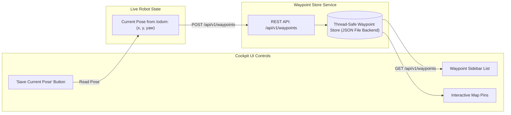

# Lesson 14: Waypoint Store & Interactive Map Marker Management

In Lesson 13, we enabled manual joystick control and arbitrary point-and-click navigation.

However, in commercial factory automation, operators and AI agents rarely navigate to random floating-point coordinates. They dispatch robots to **named semantic landmarks**:
- *"Send robot to `inspection_station_a`"*
- *"Return to `charging_dock`"*
- *"Move to `packing_zone`"*

In this lesson, you will build the **Waypoint Store**: exposing REST endpoints to save, list, and delete landmarks, implementing the **"Save Current Location as Waypoint"** workflow, and rendering custom landmark pins on the Cockpit map.

---

## 1. Learning Objectives

By the end of this lesson, you will be able to:
1. Explain the operational importance of semantic waypoints in commercial fleet management.
2. Build REST endpoints: `GET /api/v1/waypoints`, `POST /api/v1/waypoints`, and `DELETE /api/v1/waypoints/{name}`.
3. Implement the **"Save Current Location as Waypoint"** button (reading live `/odom` pose).
4. Categorize waypoints by type: `CHARGING_DOCK`, `INSPECTION_BAY`, `PICKUP_ZONE`, `REST_AREA`.
5. Render custom, interactive SVG waypoint pins on the Cockpit Canvas.

---

## 2. Waypoint Store Architecture



---

## 3. Designing the Waypoint Data Models

```python
from pydantic import BaseModel, Field
from enum import Enum
from typing import Dict, Any, List, Optional
import time


class WaypointCategory(str, Enum):
    CHARGING_DOCK = "CHARGING_DOCK"
    INSPECTION_BAY = "INSPECTION_BAY"
    PICKUP_ZONE = "PICKUP_ZONE"
    REST_AREA = "REST_AREA"
    GENERAL = "GENERAL"


class WaypointDefinition(BaseModel):
    name: str = Field(..., description="Unique alphanumeric identifier (e.g. 'station_a').")
    x: float
    y: float
    yaw: float = 0.0
    category: WaypointCategory = WaypointCategory.GENERAL
    description: str = ""
    created_at: float = Field(default_factory=time.time)


class WaypointStore:
    """Thread-safe persistent store for saved map waypoints."""

    def __init__(self, persistence_file: str = "waypoints.json"):
        self.file_path = persistence_file
        self.waypoints: Dict[str, WaypointDefinition] = {
            "charging_dock": WaypointDefinition(name="charging_dock", x=0.0, y=0.0, yaw=0.0, category=WaypointCategory.CHARGING_DOCK),
            "inspection_station_a": WaypointDefinition(name="inspection_station_a", x=4.2, y=1.5, yaw=1.57, category=WaypointCategory.INSPECTION_BAY),
            "packing_zone": WaypointDefinition(name="packing_zone", x=-2.0, y=6.8, yaw=3.14, category=WaypointCategory.PICKUP_ZONE)
        }

    def add_waypoint(self, wp: WaypointDefinition):
        self.waypoints[wp.name] = wp

    def get_all(self) -> List[WaypointDefinition]:
        return list(self.waypoints.values())

    def delete(self, name: str) -> bool:
        if name in self.waypoints:
            del self.waypoints[name]
            return True
        return False
```

---

## 4. Mounting the Waypoint Endpoints in FastAPI

```python
wp_store = WaypointStore()


@app.get("/api/v1/waypoints", response_model=List[WaypointDefinition])
async def list_waypoints():
    """Returns all saved landmarks in the active map."""
    return wp_store.get_all()


@app.post("/api/v1/waypoints", status_code=201)
async def create_waypoint(wp: WaypointDefinition):
    """Saves a new landmark with custom coordinates and metadata."""
    wp_store.add_waypoint(wp)
    return {"status": "WAYPOINT_SAVED", "waypoint": wp.name}


@app.post("/api/v1/waypoints/save_current_location", status_code=201)
async def save_current_location(name: str, category: WaypointCategory = WaypointCategory.GENERAL):
    """Takes robot's live pose from telemetry cache and saves it as a named landmark."""
    snapshot = robot_state.get_snapshot()
    wp = WaypointDefinition(
        name=name,
        x=round(snapshot["x"], 3),
        y=round(snapshot["y"], 3),
        yaw=round(snapshot["yaw"], 3),
        category=category,
        description="Saved from live robot position."
    )
    wp_store.add_waypoint(wp)
    return {"status": "SAVED", "waypoint": wp}
```

---

## 5. Rendering Waypoint Pins on the Cockpit Canvas

```javascript
class WaypointPinRenderer {
    constructor(ctx, transformer) {
        this.ctx = ctx;
        this.transformer = transformer;
        this.waypoints = [];
    }

    setWaypoints(waypointsList) {
        this.waypoints = waypointsList;
    }

    render() {
        for (const wp of this.waypoints) {
            const pt = this.transformer.worldToScreen(wp.x, wp.y);

            // Draw Pin Icon
            this.ctx.save();
            this.ctx.translate(pt.x, pt.y);

            // Distinct color per category
            const color = wp.category === "CHARGING_DOCK" ? "#10b981" : "#f59e0b";
            this.ctx.fillStyle = color;
            this.ctx.strokeStyle = "#ffffff";
            this.ctx.lineWidth = 2;

            // Pin marker circle
            this.ctx.beginPath();
            this.ctx.arc(0, -10, 8, 0, Math.PI * 2);
            this.ctx.fill();
            this.ctx.stroke();

            // Pin needle point
            this.ctx.beginPath();
            this.ctx.moveTo(0, -2);
            this.ctx.lineTo(0, 0);
            this.ctx.stroke();

            // Waypoint Label Text
            this.ctx.fillStyle = "#0f172a";
            this.ctx.font = "bold 11px sans-serif";
            this.ctx.textAlign = "center";
            this.ctx.fillText(wp.name, 0, 14);

            this.ctx.restore();
        }
    }
}
```

---

## 6. Summary & Next Steps

In this lesson, you implemented semantic landmark management:
- Enabled operators to save and dispatch named waypoints.
- Built the **"Save Current Location as Waypoint"** workflow.
- Rendered styled landmark pins directly onto the 2D map canvas.

In **Lesson 15**, we will secure our entire gateway: adding **Bearer Token Authentication, Role-Based Access Control & Rate Limiting**!
