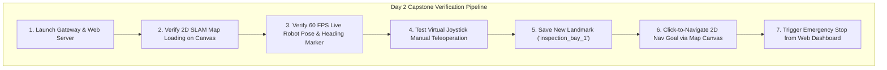

# Lesson 16: Day 2 Capstone — The Full Interactive Web Cockpit

Congratulations on reaching the **Day 2 Capstone**! Today, you designed client SDKs, implemented layered Canvas graphics, decoded SLAM occupancy grids, and built interactive virtual joysticks and waypoint stores.

In this capstone project, you will deploy and operate the complete **Interactive Web Cockpit**, connecting directly to both the Level 1 simulated robot and the physical **NavPro Mini AMR**.

---

## 1. Project Specifications

Your objective is to run and test the complete frontend cockpit stack:
- **Client SDK:** [`navpro_client.js`](../web/assets/js/app.js)
- **API Gateway Backend:** [`gateway_node.py`](../ros2_ws/src/navpro_api_gateway/navpro_api_gateway/gateway_node.py)
- **Interactive Web Interface:** [`web/index.html`](../web/index.html)



---

## 2. Step-by-Step Execution Guide

### Step 1: Launch the Robot API Gateway
In your terminal, start the ROS 2 gateway node:

```bash
cd ~/ros2_ws
source install/setup.bash
ros2 launch navpro_api_gateway gateway.launch.py
```

### Step 2: Open the Web Cockpit in Your Browser
Navigate to the NavPro Learning Hub interface:
```
http://localhost:8000
```

---

## 3. Interactive Cockpit Verification Checklist

Open your browser and verify each interactive subsystem:

### Checklist Item 1: 2D SLAM Map & Heading Alignment
- Inspect Canvas Layer 1. The grayscale occupancy grid of your warehouse/room displays with crisp obstacle borders.
- The blue robot marker sits centered at $(0, 0)$ with a white directional heading pointer pointing along $+X$.

### Checklist Item 2: Virtual Touch Joystick Teleop
- Click and drag the on-screen joystick thumb knob forward.
- Notice the linear velocity gauge increment to $+0.4\,\text{m/s}$.
- The robot marker advances on the map in real time.
- Release the joystick: the thumb knob snaps back to center and velocity cuts off to $0.0\,\text{m/s}$ immediately (deadman safety verified!).

### Checklist Item 3: Waypoint Store Management
- Drive the robot over to an interesting location on the map.
- Click the **"Save Current Location as Waypoint"** button in the sidebar.
- Enter the landmark name: `assembly_table_a`.
- A custom styled map pin appears at that exact coordinate on the canvas!

### Checklist Item 4: Click-to-Navigate 2D Nav Goal
- Click any open white space on the map and drag slightly to indicate desired orientation.
- The browser dispatches an asynchronous Nav2 goal via the Client SDK.
- A glowing dashed blue path line appears connecting the robot to your target goal.
- Watch the robot track the planned path until it reaches the target coordinates.

### Checklist Item 5: Emergency Stop Verification
- While the robot is driving towards a goal, press the large red **EMERGENCY STOP** button.
- The robot halts immediately. The status badge flashes `ESTOP_ENGAGED`.
- Verify that subsequent joystick drag attempts are rejected with `HTTP 409 Conflict`.

---

## 4. Comparing Simulation with the Physical NavPro Mini

| Feature | Level 1 Gazebo Simulation | Physical NavPro Mini AMR |
|---|---|---|
| **Map Source** | Simulated SLAM Toolbox map | Real warehouse SLAM map |
| **Telemetry Transport** | Virtual WebSocket stream | Wi-Fi 20Hz WebSocket pipe |
| **Joystick Driving** | Moves virtual robot in Gazebo | Drives physical robot across the room! |
| **Cockpit Code** | **100% Identical HTML/JS!** | **100% Identical HTML/JS!** |

*Because our Client SDK decouples the UI from the underlying hardware, the exact same cockpit code controls both simulated robots and commercial fleets!*

---

## 5. Day 2 Capstone Rubric & Deliverables

| Criteria | Points | Verification Method |
|---|---|---|
| **Client SDK Design** | 20 pts | Cleanly encapsulates HTTP endpoints and WebSocket streams. |
| **Layered Canvas Rendering** | 20 pts | Map decoded once; dynamic entities redraw smoothly at 60 FPS. |
| **Virtual Joystick Control** | 20 pts | Translates $(x, y)$ drag into metric speeds with deadman safety release. |
| **2D Nav Goal & Waypoints** | 20 pts | Click-and-drag dispatches goals; landmark pins render accurately. |
| **Emergency Stop Interlock** | 20 pts | E-Stop overrides all active motion and locks out future commands. |
| **Total** | **100 pts** | Grade: Certified Robotics Frontend & SDK Engineer! |

---

## 6. Summary & Moving to Day 3

You have successfully completed Day 2:
- Built reusable **Client SDKs** in Python and JavaScript.
- Mastered **Layered Canvas rendering** and coordinate frame conversions.
- Deployed a complete **Web Cockpit GUI** with teleoperation and waypoint saving.

In **Day 3 (Lessons 17 - 24)**, we unlock the next dimension of robotics: **Model Context Protocol (MCP)**, **Autonomous AI Agents (Claude & Gemini)**, **Stateful Mission DAGs**, and **ESP32-S3 Smartwatch Badges**!
