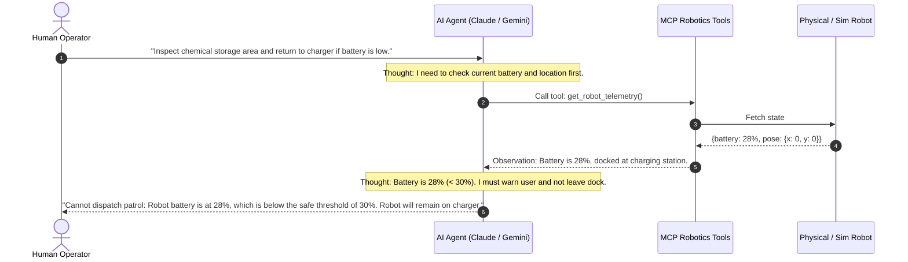

# Lesson 17: Physical AI — Grounded Reasoning vs. Stochastic Generation

Welcome to **Day 3** of the Level 2 Advanced Robotics Workshop! Over Days 1 and 2, you built an enterprise API Gateway and a complete 2D Web Cockpit GUI.

Today, we take the ultimate step in modern robotics engineering: **connecting Frontier Large Language Models (Claude 3.7, Gemini 2.0 Flash) to physical robotic systems**.

In this lesson, you will learn the foundational theory behind **Physical AI**, examining why naive text generation fails in robotics and why **Grounded Tool Calling** is the industry standard for autonomous agentic control.

---

## 1. Learning Objectives

By the end of this lesson, you will be able to:
1. Explain why naive LLM text generation cannot be trusted for direct motor control.
2. Differentiate between cognitive task planning and deterministic execution.
3. Understand the **ReAct (Reasoning + Acting)** loop in physical environments.
4. Define **Environmental Grounding** and spatial coordinate mapping for LLMs.
5. Identify the architectural boundaries between AI reasoning and ROS 2 controllers.

---

## 2. The Trap: Why Direct LLM Actuation Fails

When developers first attempt to integrate LLMs with robots, a common mistake is asking the model to directly generate motor commands or velocity values:

```
[Prompt] "Robot, drive around that table and pick up the package."
[Naive LLM Output] "Publish linear.x = 0.5 for 3.2 seconds, then turn left at 0.3 rad/s for 1.8 seconds..."
```

### Why this approach leads to catastrophic failures:
1. **No Real-Time Feedback:** The LLM does not know that wheel slip caused an orientation error at second 1.4.
2. **Hallucination of Unsafe Values:** Stochastic sampling might randomly produce a velocity of $10.0\,\text{m/s}$ or invert rotation direction.
3. **High Latency:** Calling an LLM takes $300\,\text{ms}$ to $2{,}000\,\text{ms}$. Obstacle avoidance requires $<50\,\text{ms}$ loop times!
4. **Lack of Spatial Grounding:** Words like "table" and "package" have no coordinate meaning unless mapped into metric space ($\mathbb{R}^3$).

```
        ❌ NAIVE / UNSAFE APPROACH:
        [ User Prompt ] ──> [ LLM ] ──> (Hallucinated Velocities) ──> [ Motors Crash! ]

        ✅ MODERN AGENTIC ROBOTICS ARCHITECTURE:
        [ User Prompt ] ──> [ LLM (Cognitive Planner) ]
                                    │ (Deterministic Tool Call: navigate_to_waypoint)
                                    ▼
                            [ NavPro MCP Server ]
                                    │ (Safety Pre-Flight Verification)
                                    ▼
                            [ NavPro REST API Gateway ]
                                    │ (ROS 2 Action Goal)
                                    ▼
                            [ Nav2 / EKF / LiDAR ] ──> [ Deterministic Control ]
```

---

## 3. The ReAct Architecture for Physical Robotics

In agentic robotics, we use the **ReAct (Reasoning + Acting)** framework. The AI agent alternates between internal reasoning traces and discrete tool invocations:



### Key Elements of the ReAct Trace:
- **Thought:** The LLM articulates its reasoning in plain English, analyzing its constraints before taking action.
- **Action:** The LLM outputs a strictly formatted JSON tool call matching a defined schema.
- **Observation:** The robotic tool executes and returns real sensor observations (telemetry, obstacle detection results, success/failure flags).
- **Final Answer:** The LLM synthesizes the final outcome to the human operator.

---

## 4. Environmental Grounding & Spatial Context

For an LLM to reason about a physical space, the physical world must be **grounded** into structured topological landmarks:

| Natural Language Landmark | Metric Coordinate in Map Frame | Operational Safety Notes |
|---|---|---|
| `"charging_dock"` | $(x: 0.0, y: 0.0, \theta: 0.0)$ | Low velocity approach ($0.1\,\text{m/s}$), automatic contact charging. |
| `"inspection_station_a"` | $(x: 4.2, y: 1.5, \theta: 1.57)$ | Narrow aisle; forklift traffic possible. |
| `"packing_zone"` | $(x: -2.0, y: 6.8, \theta: 3.14)$ | Human workers present; maintain $0.8\,\text{m}$ clearance buffer. |
| `"dispatch_bay"` | $(x: 8.0, y: -3.2, \theta: -0.78)$ | High-throughput loading zone. |

By exposing our Day 2 Waypoint Store to the LLM via tools, the AI agent dynamically discovers valid semantic destinations without needing to invent arbitrary floating-point numbers!

---

## 5. Summary & Next Steps

In this lesson, you mastered the foundational philosophy of Physical AI:
- LLMs serve as **high-level cognitive task planners**, while ROS 2 handles **low-level real-time closed-loop motion control**.
- Grounded Tool Calling replaces stochastic text generation with strictly validated action schemas.
- The **ReAct loop** allows agents to inspect environment state before and after each physical action.

In **Lesson 18**, you will learn the **Model Context Protocol (MCP)** specification: the universal open standard powering AI agent tool discovery and execution!
