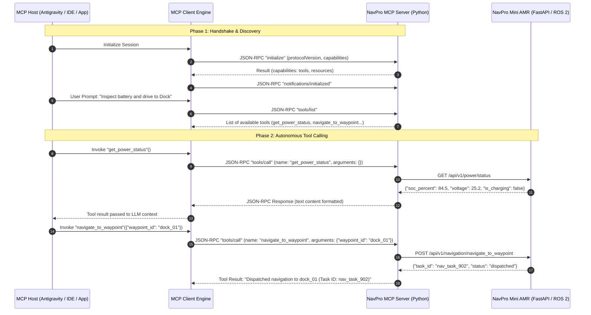
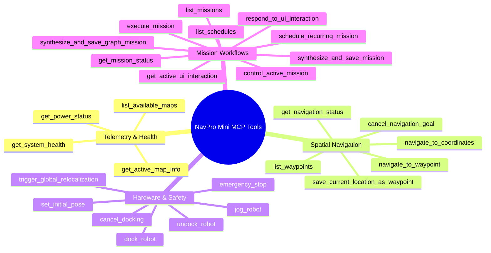

# Lesson 18: Model Context Protocol (MCP) Standard & Robotics Architecture

## Learning Objectives
By the end of this lesson, you will be able to:
1. Explain the open **Model Context Protocol (MCP)** specification and why it has replaced ad-hoc tool calling in enterprise AI robotics.
2. Diagram the **Host &harr; Client &harr; Server** architectural topology across development IDEs, desktop agents, and industrial AMRs.
3. Contrast **`stdio`** (local sub-process piping) and **`SSE` (Server-Sent Events / HTTP)** transport layers for robotic control.
4. Parse and construct standard **JSON-RPC 2.0** protocol frames for `initialize`, `tools/list`, and `tools/call`.
5. Map NavPro Mini AMR's 28 MCP tools (`navigate_to_waypoint`, `get_system_health`, `synthesize_and_save_graph_mission`) directly to ROS 2 action and service endpoints.

---

## 1. Why Model Context Protocol (MCP) for Robotics?

Before the Model Context Protocol (introduced by Anthropic in late 2024 and adopted across frontier AI assistants including Antigravity, Claude, and OpenAI-compatible frameworks), connecting Large Language Models (LLMs) to physical hardware was fragmented and brittle:

```mermaid
graph TD
    subgraph Ad-hoc Fragile Architecture (Pre-MCP)
        LLM1[LLM / Agent] -->|Custom Prompting| Script1[Ad-hoc Python Script]
        Script1 -->|Hardcoded REST| RobotA[Robot A]
        LLM1 -->|Vendor Plugin| PluginB[Vendor Tool]
        PluginB -->|Custom Driver| RobotB[Robot B]
    end

    subgraph Standardized MCP Architecture
        Host[MCP Host: Antigravity / Claude / IDE] <--> Client[MCP Client Protocol Engine]
        Client <-->|stdio or SSE JSON-RPC 2.0| MCPServer[NavPro Robotics MCP Server]
        MCPServer <-->|SDK / REST / ROS 2| AMR[NavPro Mini AMR / Nav2 Sim]
    end
```

### The Three Core Challenges MCP Solves in Robotics:
1. **Tool Schema Drift**: Pre-MCP tool calling required custom prompt engineering or platform-specific JSON schemas (OpenAI function calling format vs LangChain tools vs custom regex output parsers). MCP provides an unambiguous JSON Schema specification for tools, resources, and prompts.
2. **Context Window Starvation**: Instead of injecting thousands of lines of robot telemetry or API documentation into the LLM system prompt, MCP provides **Lazy Dynamic Discovery**: the host queries `tools/list` on demand, and retrieves state through `resources/read`.
3. **Transport Independence**: The same robotics tool server can run locally inside a developer's CLI/IDE over standard input/output (`stdio`) or deploy on an autonomous mobile robot's on-board computer over HTTP Server-Sent Events (`SSE`).

---

## 2. MCP Architectural Topology

An MCP-enabled robotics deployment consists of three distinct layers:



### Roles Defined:
- **MCP Host**: The front-end AI runtime environment (e.g., Antigravity CLI/IDE, Claude Desktop, autonomous orchestrator agent). It manages user conversations, token budgets, and LLM inference.
- **MCP Client**: The protocol connector inside the host that maintains an active transport session (stdio subprocess or SSE stream) with the server.
- **MCP Server**: A lightweight executable service that exposes domain capabilities (tools, resources, prompts) through the standardized JSON-RPC 2.0 interface. In our architecture, the **NavPro MCP Server** bridges MCP tool calls to the FastAPI Robot Gateway and Nav2 ROS 2 subsystem.

---

## 3. Transport Layers: `stdio` vs `SSE`

| Feature | `stdio` Transport | `SSE` (Server-Sent Events) Transport |
| :--- | :--- | :--- |
| **Connection Mechanism** | Host spawns server process as child subprocess; communicates via `stdin` & `stdout` | Host connects via HTTP `GET` stream for events; sends JSON-RPC commands via HTTP `POST` |
| **Typical Deployment** | Local developer workstation, AGY CLI, local simulator | Distributed robotics, AMR on-board compute, cloud fleet manager |
| **Network Overhead** | Zero network latency; local OS pipes | Minimal HTTP headers; uses standard TCP/TLS socket |
| **Standard Output Discipline** | **Critical**: Server MUST NEVER print logs to `stdout`. All logs MUST go to `stderr` or file | Logs can go to `stdout`/`stderr` normally; HTTP endpoint handles protocol payload |
| **Security Scope** | Inherits local user permissions of Host process | Protected by Bearer Tokens, TLS/HTTPS, and network firewalls |

> [!WARNING] The Golden Rule of `stdio` MCP Servers
> When building an MCP server running over `stdio`, any `print("Robot connected!")` statement sent to `sys.stdout` will **corrupt the JSON-RPC message stream** and immediately crash the MCP client parser! All debugging, telemetry, and informational logs **MUST** be routed to `sys.stderr` or a dedicated log file (`logging.basicConfig(stream=sys.stderr)`).

---

## 4. The JSON-RPC 2.0 Wire Protocol

MCP standardizes all interactions on **JSON-RPC 2.0**. Let's examine the exact payloads exchanged across the wire.

### 4.1 Handshake (`initialize`)
**Request from Client:**
```json
{
  "jsonrpc": "2.0",
  "id": 1,
  "method": "initialize",
  "params": {
    "protocolVersion": "2024-11-05",
    "capabilities": {
      "roots": { "listChanged": true },
      "sampling": {}
    },
    "clientInfo": {
      "name": "antigravity-agent",
      "version": "2.0.0"
    }
  }
}
```

**Response from Server:**
```json
{
  "jsonrpc": "2.0",
  "id": 1,
  "result": {
    "protocolVersion": "2024-11-05",
    "capabilities": {
      "tools": { "listChanged": true },
      "resources": { "subscribe": false, "listChanged": true }
    },
    "serverInfo": {
      "name": "navpromini-mcp-server",
      "version": "1.0.0"
    }
  }
}
```

---

### 4.2 Dynamic Tool Discovery (`tools/list`)
**Request from Client:**
```json
{
  "jsonrpc": "2.0",
  "id": 2,
  "method": "tools/list",
  "params": {}
}
```

**Response from Server (Tool Schemas):**
```json
{
  "jsonrpc": "2.0",
  "id": 2,
  "result": {
    "tools": [
      {
        "name": "get_power_status",
        "description": "Returns current battery state of charge (percentage), voltage, current, and charging status.",
        "inputSchema": {
          "type": "object",
          "properties": {},
          "required": []
        }
      },
      {
        "name": "navigate_to_waypoint",
        "description": "Dispatches the AMR to a named waypoint landmark registered in the active semantic map.",
        "inputSchema": {
          "type": "object",
          "properties": {
            "waypoint_id": {
              "type": "string",
              "description": "Unique identifier of the destination waypoint (e.g. 'station_dock', 'storage_bay_b')."
            }
          },
          "required": ["waypoint_id"]
        }
      }
    ]
  }
}
```

---

### 4.3 Tool Invocation (`tools/call`)
**Request from Client:**
```json
{
  "jsonrpc": "2.0",
  "id": 3,
  "method": "tools/call",
  "params": {
    "name": "navigate_to_waypoint",
    "arguments": {
      "waypoint_id": "storage_bay_b"
    }
  }
}
```

**Response from Server:**
```json
{
  "jsonrpc": "2.0",
  "id": 3,
  "result": {
    "content": [
      {
        "type": "text",
        "text": "Successfully dispatched AMR navigation to waypoint 'storage_bay_b'. Task ID: nav_task_104. Distance: 4.82m."
      }
    ],
    "isError": false
  }
}
```

---

## 5. NavPro Mini AMR's MCP Server Tool Catalog

In physical deployments of the **NavPro Mini AMR**, the robot runs an MCP server exposing 28 production tools categorized into four operational tiers:



In the next lesson, we will construct our own Python MCP server from scratch that connects directly to the FastAPI Gateway we built in Day 1!

---

## Practical Exercise: Inspecting the MCP Server Schema

### Step 1: Open the NavPro Mini MCP Schema Directory
Explore how MCP lazily defines schemas in our environment:
```bash
ls -la /home/chaitu/.gemini/antigravity-cli/mcp/navpromini/
```

### Step 2: Read an MCP Tool Schema
Inspect the exact JSON schema definition for the waypoint navigation tool:
```bash
cat /home/chaitu/.gemini/antigravity-cli/mcp/navpromini/navigate_to_waypoint.json
```

Observe how `description`, `properties`, and `required` parameters are strictly structured to enable LLM tool-calling reliability.

---

## Summary
- **Model Context Protocol (MCP)** standardizes how AI agents discover and execute robotic actions over `stdio` and `SSE`.
- The architecture cleanly decouples the **Host** (reasoning & user interaction) from the **Server** (robot execution & safety validation).
- Standard JSON-RPC 2.0 messages handle initialization, tool discovery, and invocation deterministically.
- Logging to `stderr` is mandatory in `stdio` servers to prevent JSON-RPC stream corruption.
- In **Lesson 19**, we will implement a fully functioning Python MCP server for our simulated robot!
