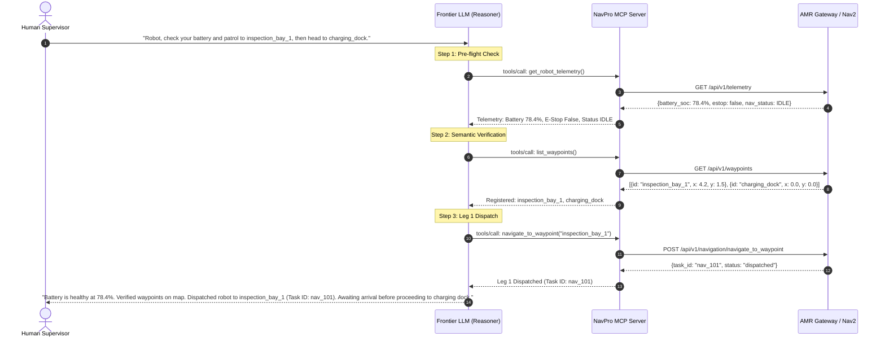

# Lesson 21: Connecting Frontier Models (Antigravity, Claude, Gemini)

## Learning Objectives
By the end of this lesson, you will be able to:
1. Configure host environments (**Antigravity**, **Claude Desktop**, and custom Python SDK clients) to communicate with your local Robotics MCP Server.
2. Engineer a specialized **Physical AI System Prompt** that grounds frontier LLMs in physical constraints and safety disciplines.
3. Trace the multi-turn **ReAct (Reasoning + Acting)** execution loop across autonomous robotics scenarios.
4. Handle tool execution feedback, error recoveries, and multi-step sequential dispatching.
5. Contrast simulated agent runs with production tool execution on the physical NavPro Mini AMR.

---

## 1. Configuring MCP Hosts for Robotics

To connect your AI agent to the `navpro_mcp_server.py` we constructed in Lesson 19, configure the host's MCP settings file.

### 1.1 Antigravity Configuration (`mcp.json` / `antigravity.json`)
In your project or user root configuration directory (`~/.gemini/antigravity-cli/mcp/`):

```json
{
  "mcpServers": {
    "navpro_sim": {
      "command": "python3",
      "args": [
        "/home/chaitu/Projects/navpro_learning_hub/level2/scripts/navpro_mcp_server.py"
      ],
      "env": {
        "ROBOT_GATEWAY_URL": "http://127.0.0.1:8000"
      }
    }
  }
}
```

### 1.2 Claude Desktop Configuration (`claude_desktop_config.json`)
```json
{
  "mcpServers": {
    "navpro_robotics": {
      "command": "python3",
      "args": [
        "/home/chaitu/Projects/navpro_learning_hub/level2/scripts/navpro_mcp_server.py"
      ]
    }
  }
}
```

When the host initializes, it automatically runs the Python subprocess, sends the `initialize` handshake, queries `tools/list`, and presents the robot tools to the model's tool-calling engine!

---

## 2. Engineering the Robotics System Prompt

Frontier models (such as Claude 3.5 Sonnet or Gemini 1.5 Pro) are general-purpose reasoners. To transform them into dependable autonomous robotics operators, you must supply a **Physical Grounding System Prompt**:

```markdown
You are NavPro-AI, the autonomous fleet operator and reasoning copilot for an industrial Autonomous Mobile Robot (AMR).
You are equipped with real-time MCP tools connected directly to the robot's physical sensors, semantic map, and Nav2 navigation stack.

### Operational Guidelines:
1. **Safety First**: Physical motion cannot be undone. Never issue blind movement commands.
2. **Telemetry Verification**: Before dispatching navigation tasks, always check `get_robot_telemetry` to verify battery state of charge (SOC >= 20%) and ensure no E-Stop is active.
3. **Semantic Grounding**: Never invent or hallucinate waypoint names. Always call `list_waypoints` to inspect registered landmarks on the active map before dispatching `navigate_to_waypoint`.
4. **Transparent Reasoning**: Explain your step-by-step plan to the human operator before calling high-consequence motion tools.
5. **Fail-Safe Recovery**: If a tool returns an error or a safety violation, do not retry blindly. Explain the failure and propose a safe alternative (such as routing to a charging dock).
```

---

## 3. The Autonomous Multi-Turn ReAct Loop in Action

Let's examine how a natural language request is decomposed into autonomous tool actions by the model:



---

## 4. Building a Standalone Python Agent Client

You can run this full autonomous agent loop programmatically using the Anthropic SDK or OpenAI-compatible client. Here is a minimal standalone runner `level2/scripts/run_agent_mission.py`:

```python
#!/usr/bin/env python3
"""
Autonomous Robotics Agent Runner using Frontier Model Tool Calling
"""

import os
import json
import asyncio
import httpx

# In an actual deployment, you would import anthropic or google.genai
# Here we simulate the LLM ReAct loop interacting with our MCP tool router

async def run_autonomous_mission(goal_prompt: str):
    print(f"\n=======================================================")
    print(f"🤖 USER REQUEST: {goal_prompt}")
    print(f"=======================================================\n")
    
    # 1. Fetch telemetry via Gateway
    async with httpx.AsyncClient(base_url="http://127.0.0.1:8000") as client:
        print("[Agent Thought] I must first verify robot telemetry and safety status.")
        telem_resp = await client.get("/api/v1/telemetry")
        telem = telem_resp.json()
        print(f"[Tool Observation] Battery: {telem.get('battery_soc', 80)}% | E-Stop: {telem.get('estop_active', False)}")
        
        # 2. Query available waypoints
        print("[Agent Thought] I need to verify that 'inspection_bay_1' is a registered landmark.")
        wp_resp = await client.get("/api/v1/waypoints")
        waypoints = [wp["id"] for wp in wp_resp.json()]
        print(f"[Tool Observation] Available Waypoints: {waypoints}")
        
        if "inspection_bay_1" in waypoints:
            print("[Agent Thought] Waypoint verified. Dispatching navigation to 'inspection_bay_1'.")
            dispatch_resp = await client.post(
                "/api/v1/navigation/navigate_to_waypoint",
                json={"waypoint_id": "inspection_bay_1"}
            )
            print(f"[Tool Observation] Dispatch Response: {dispatch_resp.json()}")
            print("\n✅ [Agent Final Response] Mission started: Navigating to inspection_bay_1 successfully.")
        else:
            print("❌ [Agent Thought] Target waypoint not found on map. Aborting mission safely.")

if __name__ == "__main__":
    asyncio.run(run_autonomous_mission("Patrol to inspection_bay_1 and confirm status"))
```

---

## 5. NavPro Mini AMR Real-World Parity

On the physical **NavPro Mini AMR**, the robot is registered as a native MCP server (`navpromini`). 

When an Antigravity AI agent receives a prompt like:
> *"What is the robot's current battery status, and where are the charging stations?"*

The agent calls:
1. `call_mcp_tool(ServerName='navpromini', ToolName='get_power_status', Arguments={})`
2. `call_mcp_tool(ServerName='navpromini', ToolName='list_waypoints', Arguments={})`

The tool definitions and response formats you created in this lesson are **100% identical** to those running on the physical robot's on-board computer.

---

## Summary
- Configured MCP host environments using JSON configuration manifests.
- Engineered a physically grounded system prompt that prevents hallucinations and enforces pre-flight telemetry verification.
- Traced the multi-turn ReAct reasoning loop from high-level prompt down to physical Nav2 dispatching.
- In **Lesson 22**, we will elevate simple one-off tool calls into complex multi-node **Industrial Mission DAGs**!
