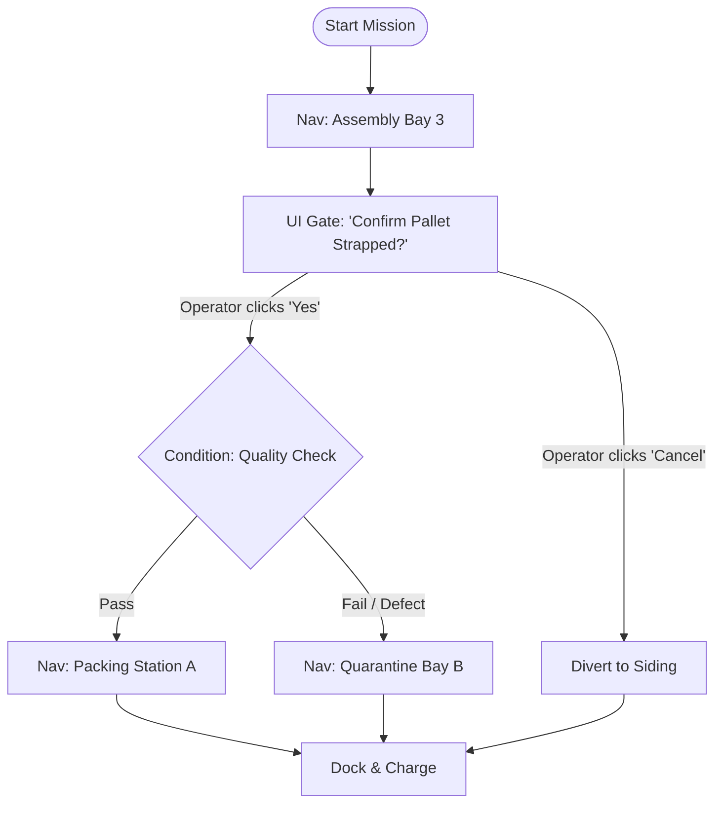

# Lesson 22: Industrial Mission Graph & DAG Architecture

## Learning Objectives
By the end of this lesson, you will be able to:
1. Explain why industrial AMR operations require stateful **Directed Acyclic Graphs (DAGs)** rather than simple linear waypoint queues.
2. Define the schema of **NavPro Mission Graph Nodes** (`navigation`, `delay`, `ui_interaction`, `condition_branch`, `dock`).
3. Construct directed edge transitions supporting deterministic condition branches and error fallbacks.
4. Implement topological sort and cycle-detection validation (Kahn's algorithm) to guarantee execution termination.
5. Contrast custom DAG JSON schemas with the physical NavPro Mini AMR's `synthesize_and_save_graph_mission` tool and Cockpit visual node editor.

---

## 1. Why Linear Waypoint Lists Fail in Enterprise AMR Deployments

In introductory robotics tutorials, autonomous missions are often represented as a flat array:
```json
["go_to_wp_1", "go_to_wp_2", "go_to_dock"]
```

In real-world manufacturing plants, warehouses, and hospitals, **linear execution is insufficient**:
- **Human-in-the-Loop Gating**: The AMR arrives at Assembly Bay 3. It cannot move until an operator confirms that the pallet has been strapped.
- **Conditional Branching**: The AMR reads a barcode. If the barcode is Valid &rarr; route to Packing Station A; if Damaged &rarr; route to Quarantine Bay B.
- **Error Recovery Branches**: If path planning fails after 3 retries &rarr; sound warning buzzer and divert to safe maintenance siding rather than stopping dead in the traffic lane.

This requires a **Mission Graph (DAG)**:



---

## 2. NavPro Mission Graph JSON Schema Specification

Let's examine the standard JSON schema that defines a stateful mission graph:

```json
{
  "mission_id": "mission_patrol_and_inspect_01",
  "name": "Warehouse Inspection & Pallet Transfer",
  "version": "1.0.0",
  "start_node_id": "nav_to_bay_1",
  "nodes": [
    {
      "id": "nav_to_bay_1",
      "type": "navigation",
      "params": {
        "waypoint_id": "assembly_bay_1",
        "tolerance_meters": 0.25
      },
      "next_node_id": "gate_operator_inspection"
    },
    {
      "id": "gate_operator_inspection",
      "type": "ui_interaction",
      "params": {
        "title": "Pallet Transfer Ready",
        "prompt": "Operator: Confirm parts are loaded onto tray.",
        "options": ["Confirmed", "Reject / Empty"],
        "timeout_seconds": 300
      },
      "conditional_transitions": {
        "Confirmed": "nav_to_storage",
        "Reject / Empty": "nav_to_dock"
      }
    },
    {
      "id": "nav_to_storage",
      "type": "navigation",
      "params": {
        "waypoint_id": "storage_bay_b",
        "tolerance_meters": 0.25
      },
      "next_node_id": "delay_settle"
    },
    {
      "id": "delay_settle",
      "type": "delay",
      "params": {
        "duration_seconds": 5.0
      },
      "next_node_id": "nav_to_dock"
    },
    {
      "id": "nav_to_dock",
      "type": "dock",
      "params": {
        "dock_id": "charging_dock_1"
      },
      "next_node_id": null
    }
  ]
}
```

---

## 3. Core Mission Node Types

| Node Type | Execution Behavior | Output State / Branch Keys |
| :--- | :--- | :--- |
| **`navigation`** | Dispatches Nav2 action goal to coordinates or named waypoint. Blocks until goal reached. | `SUCCESS`, `ABORTED`, `CANCELED` |
| **`delay`** | Pauses mission execution for $N$ seconds (e.g. sensor readings, mechanical latching). | `SUCCESS` |
| **`ui_interaction`** | Displays interactive prompt on Cockpit GUI and ESP32 smartwatch. Suspends execution until operator responds. | Selected Option String (e.g. `"Confirmed"`, `"Reject"`) |
| **`condition_branch`** | Evaluates a boolean logic expression against telemetry (e.g. `battery_soc > 50`). | `"true"`, `"false"` |
| **`dock`** | Invokes precision infrared / laser docking server. Terminal or intermediate state. | `SUCCESS`, `DOCK_FAILED` |

---

## 4. Graph Validation: Detecting Cycles & Dangling Edges

Before executing a mission graph on physical hardware, we must mathematically guarantee that:
1. Every referenced `next_node_id` exists in the node list (no dangling pointers).
2. The graph contains **no infinite cycles** (is a true DAG).
3. Every path terminates cleanly at an exit node (`next_node_id: null`).

Here is the validation algorithm using Kahn's topological sort in Python (`level2/scripts/validate_mission_graph.py`):

```python
"""
Mission Graph Topological Validator (Kahn's Algorithm)
"""

from typing import Dict, Any, List, Set

class MissionGraphValidationError(Exception):
    pass

def validate_mission_graph(graph_data: Dict[str, Any]) -> bool:
    nodes = {node["id"]: node for node in graph_data.get("nodes", [])}
    if not nodes:
        raise MissionGraphValidationError("Graph contains no nodes.")

    start_node = graph_data.get("start_node_id")
    if start_node not in nodes:
        raise MissionGraphValidationError(f"start_node_id '{start_node}' not found in nodes.")

    # 1. Build adjacency list & compute in-degrees
    in_degree = {nid: 0 for nid in nodes}
    adjacency: Dict[str, List[str]] = {nid: [] for nid in nodes}

    for nid, node in nodes.items():
        # Check direct next_node_id
        next_id = node.get("next_node_id")
        if next_id:
            if next_id not in nodes:
                raise MissionGraphValidationError(f"Node '{nid}' references non-existent node '{next_id}'.")
            adjacency[nid].append(next_id)
            in_degree[next_id] += 1

        # Check conditional transitions
        cond_trans = node.get("conditional_transitions", {})
        for option, target_id in cond_trans.items():
            if target_id not in nodes:
                raise MissionGraphValidationError(f"Conditional transition '{option}' in '{nid}' references non-existent node '{target_id}'.")
            adjacency[nid].append(target_id)
            in_degree[target_id] += 1

    # 2. Kahn's Algorithm: Cycle Detection
    queue = [nid for nid, deg in in_degree.items() if deg == 0]
    visited_count = 0

    while queue:
        curr = queue.pop(0)
        visited_count += 1
        for neighbor in adjacency[curr]:
            in_degree[neighbor] -= 1
            if in_degree[neighbor] == 0:
                queue.append(neighbor)

    if visited_count != len(nodes):
        raise MissionGraphValidationError("Cycle detected! Mission graph must be a Directed Acyclic Graph (DAG).")

    return True
```

---

## 5. Physical AMR Parity: NavPro Mini's MCP Mission Synthesis

On the physical **NavPro Mini AMR**, Frontier AI models synthesize complete mission DAGs directly from voice or chat using the MCP tool:
```python
call_mcp_tool(
    ServerName="navpromini",
    ToolName="synthesize_and_save_graph_mission",
    Arguments={
        "mission_name": "Shift Change Patrol",
        "nodes": [...],
        "start_node_id": "nav_to_bay_1"
    }
)
```

In the NavPro Cockpit, human operators can inspect the synthesized graph visually, re-order nodes with drag-and-drop, and monitor live progress as nodes change color from **PENDING** &rarr; **RUNNING** &rarr; **COMPLETED**.

---

## Summary
- Industrial AMR workflows require **Directed Acyclic Graphs (DAGs)** to handle human approvals, condition branches, and fault recoveries.
- Nodes represent discrete operations (`navigation`, `ui_interaction`, `delay`, `dock`); edges represent state transitions.
- Graph validation using Kahn's algorithm guarantees absence of dangling edges or infinite cycles before physical actuation.
- In **Lesson 23**, we will build the **Stateful Mission Runner Engine** that executes this DAG and dispatches UI approval cards to web and smartwatch badges!
