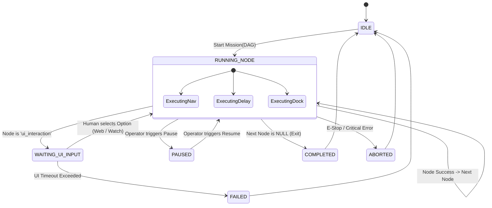
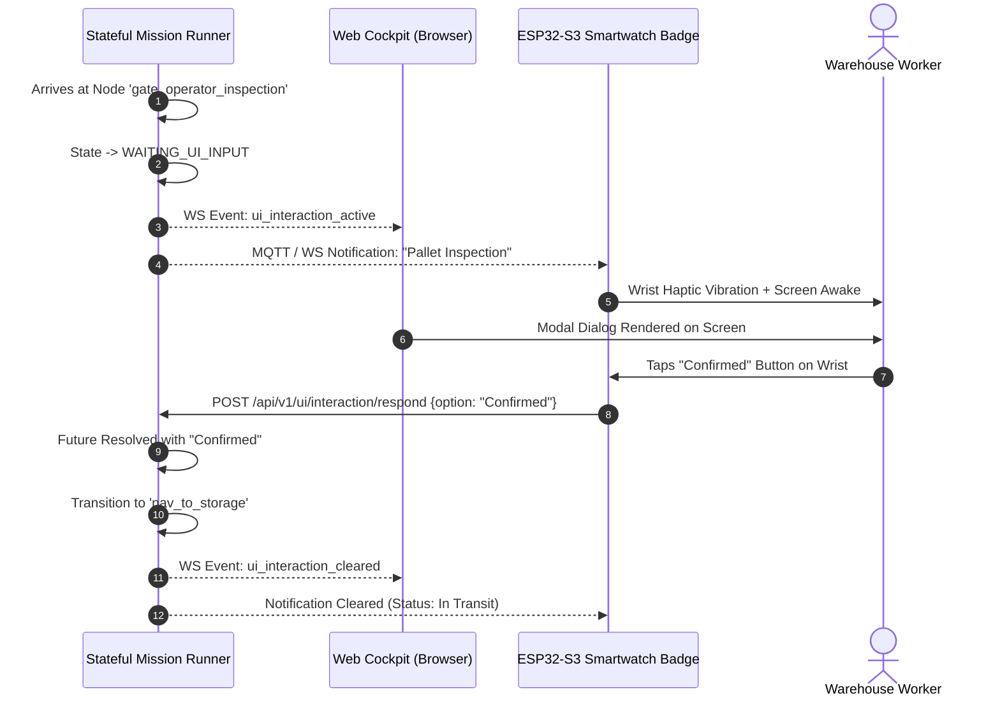

# Lesson 23: Stateful Mission Runner & Human-in-the-Loop UI Gates

## Learning Objectives
By the end of this lesson, you will be able to:
1. Design and code a stateful **Mission Execution Finite State Machine (FSM)** in Python.
2. Implement **Human-in-the-Loop UI Gates** that suspend autonomous execution until human confirmation is received.
3. Expose interactive gate state to the Web Cockpit and **ESP32-S3 Smartwatch Badge** over WebSockets and REST.
4. Process asynchronous user responses (`respond_to_ui_interaction`) and transition the DAG to the selected conditional branch.
5. Demonstrate full mission execution lifecycle with automated node status tracking.

---

## 1. The Mission Runner Finite State Machine (FSM)

An autonomous mission runner cannot be a blocking script. It must be an asynchronous event-driven state machine:



---

## 2. Implementing the Mission Runner (`mission_runner.py`)

Create `level2/scripts/mission_runner.py` with an asynchronous execution loop:

```python
"""
Stateful Mission DAG Runner with Human-in-the-Loop UI Interaction Gates
"""

import asyncio
import logging
import time
from typing import Dict, Any, Optional

logger = logging.getLogger("mission_runner")

class MissionState:
    IDLE = "IDLE"
    RUNNING = "RUNNING"
    WAITING_UI_INPUT = "WAITING_UI_INPUT"
    PAUSED = "PAUSED"
    COMPLETED = "COMPLETED"
    FAILED = "FAILED"
    ABORTED = "ABORTED"

class StatefulMissionRunner:
    def __init__(self, gateway_client):
        self.client = gateway_client
        self.state = MissionState.IDLE
        self.current_mission: Optional[Dict[str, Any]] = None
        self.current_node_id: Optional[str] = None
        self.active_ui_interaction: Optional[Dict[str, Any]] = None
        self.ui_response_future: Optional[asyncio.Future] = None

    async def start_mission(self, mission_dag: Dict[str, Any]) -> str:
        """Initialize and begin execution of a validated mission DAG."""
        if self.state not in (MissionState.IDLE, MissionState.COMPLETED):
            return f"Cannot start: Mission runner is currently in state {self.state}."

        self.current_mission = mission_dag
        self.current_node_id = mission_dag["start_node_id"]
        self.state = MissionState.RUNNING
        logger.info(f"Started mission '{mission_dag.get('name')}' at node '{self.current_node_id}'")

        # Spawn non-blocking execution task
        asyncio.create_task(self._execution_loop())
        return "Mission started successfully."

    async def _execution_loop(self):
        nodes_map = {n["id"]: n for n in self.current_mission["nodes"]}

        while self.state == MissionState.RUNNING and self.current_node_id:
            node = nodes_map.get(self.current_node_id)
            if not node:
                logger.error(f"Node '{self.current_node_id}' missing from mission definition.")
                self.state = MissionState.FAILED
                break

            node_type = node.get("type")
            logger.info(f"Executing node '{self.current_node_id}' (Type: {node_type})")

            # Execute according to node type
            next_node = None
            if node_type == "navigation":
                next_node = await self._exec_navigation_node(node)
            elif node_type == "delay":
                next_node = await self._exec_delay_node(node)
            elif node_type == "ui_interaction":
                next_node = await self._exec_ui_interaction_node(node)
            elif node_type == "dock":
                next_node = await self._exec_dock_node(node)
            else:
                logger.warning(f"Unknown node type '{node_type}'. Skipping.")
                next_node = node.get("next_node_id")

            # Check termination
            self.current_node_id = next_node
            if not self.current_node_id:
                logger.info("Terminal node reached. Mission COMPLETED.")
                self.state = MissionState.COMPLETED
                break

    async def _exec_navigation_node(self, node: Dict[str, Any]) -> Optional[str]:
        wp_id = node.get("params", {}).get("waypoint_id")
        logger.info(f"Navigating to waypoint '{wp_id}'...")
        # Dispatch to gateway
        resp = await self.client.post("/api/v1/navigation/navigate_to_waypoint", json={"waypoint_id": wp_id})
        # Simulate awaiting Nav2 arrival
        await asyncio.sleep(2.0)
        return node.get("next_node_id")

    async def _exec_delay_node(self, node: Dict[str, Any]) -> Optional[str]:
        duration = node.get("params", {}).get("duration_seconds", 1.0)
        logger.info(f"Settling for {duration} seconds...")
        await asyncio.sleep(duration)
        return node.get("next_node_id")

    async def _exec_ui_interaction_node(self, node: Dict[str, Any]) -> Optional[str]:
        params = node.get("params", {})
        self.active_ui_interaction = {
            "node_id": node["id"],
            "title": params.get("title", "Action Required"),
            "prompt": params.get("prompt", ""),
            "options": params.get("options", ["Confirm"]),
            "timestamp": time.time()
        }
        self.state = MissionState.WAITING_UI_INPUT
        self.ui_response_future = asyncio.get_event_loop().create_future()

        logger.info(f"Suspended execution. Waiting for operator input: '{params.get('prompt')}'")

        try:
            # Wait for response with timeout
            timeout = params.get("timeout_seconds", 120)
            selected_option = await asyncio.wait_for(self.ui_response_future, timeout=timeout)
            logger.info(f"Operator responded: '{selected_option}'")
            self.state = MissionState.RUNNING
            self.active_ui_interaction = None

            # Resolve next node from conditional transitions
            transitions = node.get("conditional_transitions", {})
            return transitions.get(selected_option, node.get("next_node_id"))
        except asyncio.TimeoutError:
            logger.error("UI Interaction timed out. Mission marked FAILED.")
            self.state = MissionState.FAILED
            self.active_ui_interaction = None
            return None

    def submit_ui_response(self, option: str) -> bool:
        """Invoked when operator responds via Web Cockpit or ESP32 Smartwatch."""
        if self.state == MissionState.WAITING_UI_INPUT and self.ui_response_future:
            if not self.ui_response_future.done():
                self.ui_response_future.set_result(option)
                return True
        return False
```

---

## 3. Human Interaction Flow on Web Cockpit and ESP32 Smartwatch

When the Mission Runner enters `WAITING_UI_INPUT`:
1. It broadcasts a WebSocket event to all connected clients:
```json
{
  "event": "ui_interaction_active",
  "data": {
    "node_id": "gate_operator_inspection",
    "title": "Pallet Inspection",
    "prompt": "Operator: Confirm parts are loaded onto tray.",
    "options": ["Confirmed", "Reject / Empty"]
  }
}
```
2. **The Web Cockpit** pops up an interactive modal card in the bottom navigation tray.
3. **The ESP32-S3 Smartwatch Badge** vibrates on the warehouse worker's wrist and displays the prompt with tactile physical buttons:
   - **Button 1 (Top)**: Selects *"Confirmed"*
   - **Button 2 (Bottom)**: Selects *"Reject / Empty"*



---

## 4. Testing the Full Interactive Gate Loop

You can simulate the entire gate sequence in Python without physical hardware:

```python
# Simulate Mission Runner execution
runner = StatefulMissionRunner(gateway_client=mock_client)
await runner.start_mission(mission_dag)

# Check active prompt
assert runner.state == MissionState.WAITING_UI_INPUT
print(f"Active Prompt: {runner.active_ui_interaction['prompt']}")

# Simulate worker tapping 'Confirmed' on their wrist badge
runner.submit_ui_response("Confirmed")

# Execution resumes autonomously!
await asyncio.sleep(1.0)
assert runner.state == MissionState.RUNNING
```

---

## Summary
- Stateful mission execution requires a decoupled asynchronous Finite State Machine.
- `ui_interaction` nodes allow physical AMRs to safely collaborate with human warehouse workers.
- The state machine suspends execution deterministically until a response is submitted from the Web Cockpit or ESP32 Smartwatch Badge.
- In **Lesson 24**, we bring all three days together in the **End-to-End Grand Capstone Fleet Pipeline**!
