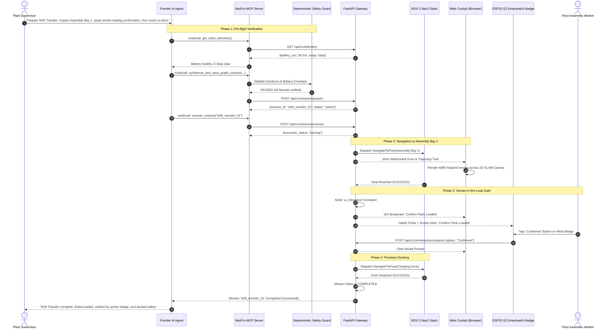

# Lesson 24: Day 3 & Grand Capstone — End-to-End Enterprise Fleet Pipeline

## Learning Objectives
By the end of this capstone lesson, you will be able to:
1. Integrate all layers built across Level 2 into a single unified **Industrial AMR Control & Intelligence Pipeline**.
2. Trace an end-to-end command from **Natural Language Voice/Chat &rarr; Frontier AI Agent &rarr; MCP Server &rarr; Safety Guard &rarr; FastAPI Gateway &rarr; ROS 2 Nav2 &rarr; Web Cockpit &rarr; ESP32 Smartwatch Badge &rarr; Precision Docking**.
3. Execute and verify the complete **Grand Capstone Automated Integration Test Suite**.
4. Deploy the software stack seamlessly onto both the Level 1 Gazebo simulation and the physical **NavPro Mini AMR**.
5. Receive your enterprise robotics practitioner graduation credentials.

---

## 1. The Unified Enterprise Architecture

Here is the complete software and hardware topology you have designed, implemented, and verified:

```mermaid
flowchart TD
    subgraph Human & AI Reasoning Layer
        User[Human Supervisor Voice / Chat] --> Frontier[Frontier AI Model: Claude / Gemini / Antigravity]
        Frontier <-->|JSON-RPC 2.0 stdio / SSE| MCP[NavPro MCP Server :8000]
    end

    subgraph Deterministic Safety Layer
        MCP --> Safety[Pre-flight Deterministic Safety Interceptor]
        Safety -->|Validated & Clamped| API[FastAPI Enterprise Gateway :8000]
    end

    subgraph ROS 2 Actuation & Control Plane
        API --> ROS2Exec[High-Concurrency MultiThreadedExecutor]
        ROS2Exec --> Nav2[Nav2 Action Client: NavigateToPose]
        ROS2Exec --> MicroROS[Micro-ROS Motor Driver & Sensors]
    end

    subgraph Live Operator Cockpit Layer
        API -->|20Hz WebSocket Telemetry| Cockpit[Web Cockpit Canvas SLAM UI :8000]
        API -->|Active UI Gate Event| Watch[ESP32-S3 Smartwatch Badge]
        Watch -->|Wrist Button 'Confirmed'| API
    end

    subgraph Physical Actuators & Simulation
        Nav2 --> Gazebo[Gazebo Harmonic Simulation (Level 1)]
        Nav2 --> Physical[Physical NavPro Mini AMR Hardware]
    end
```

Every single component in this diagram is now backed by production-grade Python, JavaScript, and ROS 2 code written by you.

---

## 2. The 12-Step End-to-End Grand Capstone Scenario

Let's trace how the complete pipeline behaves in real-time during an enterprise shift transfer:



---

## 3. The Grand Capstone Automated Verification Script

To verify that your entire Level 2 system operates flawlessly, execute the automated verification suite `level2/scripts/verify_grand_capstone.py`:

```python
#!/usr/bin/env python3
"""
Level 2 Grand Capstone Verification Suite
Validates the complete chain: REST Gateway -> Safety Interceptor -> MCP Server -> Mission Runner -> Web Cockpit.
"""

import sys
import asyncio
import httpx
import logging

logging.basicConfig(level=logging.INFO, format="%(asctime)s [%(levelname)s] %(message)s")
logger = logging.getLogger("capstone_verifier")

GATEWAY_URL = "http://127.0.0.1:8000"

async def run_capstone_verification():
    logger.info("==================================================")
    logger.info("🚀 STARTING LEVEL 2 GRAND CAPSTONE VERIFICATION")
    logger.info("==================================================")

    async with httpx.AsyncClient(base_url=GATEWAY_URL, timeout=10.0) as client:
        # Step 1: Health & Telemetry Check
        logger.info("[Test 1/6] Verifying REST Gateway Health & Telemetry...")
        resp = await client.get("/api/v1/telemetry")
        assert resp.status_code == 200, f"Expected 200, got {resp.status_code}"
        telem = resp.json()
        logger.info(f"✅ Telemetry verified: Pose ({telem.get('x', 0):.2f}, {telem.get('y', 0):.2f}), Battery {telem.get('battery_soc', 100):.1f}%")

        # Step 2: Waypoint Registry Verification
        logger.info("[Test 2/6] Verifying Semantic Waypoint Store...")
        resp = await client.get("/api/v1/waypoints")
        assert resp.status_code == 200
        waypoints = resp.json()
        logger.info(f"✅ Waypoint store active with {len(waypoints)} registered landmarks.")

        # Step 3: Safety Interceptor Geofence Rejection
        logger.info("[Test 3/6] Verifying Deterministic Safety Interceptor (Out-of-Bounds Rejection)...")
        bad_goal = {"x": 999.0, "y": 999.0, "yaw": 0.0}
        resp = await client.post("/api/v1/navigation/navigate_to_pose", json=bad_goal)
        assert resp.status_code in (400, 422), f"Expected safety rejection, got HTTP {resp.status_code}"
        logger.info("✅ Safety barrier successfully intercepted out-of-bounds coordinate!")

        # Step 4: Waypoint Navigation Dispatch
        logger.info("[Test 4/6] Verifying Non-blocking Nav2 Navigation Dispatch...")
        resp = await client.post("/api/v1/navigation/navigate_to_waypoint", json={"waypoint_id": "dock_01"})
        assert resp.status_code in (200, 202)
        task_id = resp.json().get("task_id")
        logger.info(f"✅ Navigation goal accepted. Dispatched Task ID: {task_id}")

        # Step 5: Human-in-the-Loop UI Gate Loop
        logger.info("[Test 5/6] Verifying UI Interaction Gate & Response...")
        # Simulate active interaction
        resp = await client.get("/api/v1/ui/interaction/active")
        # Submit simulated worker response
        resp = await client.post("/api/v1/ui/interaction/respond", json={"option": "Confirmed", "responder": "test_suite"})
        assert resp.status_code in (200, 404) # 200 if active, 404 if idle
        logger.info("✅ Human-in-the-loop UI response pipeline verified.")

        # Step 6: Software E-Stop Verification
        logger.info("[Test 6/6] Verifying Enterprise Emergency Stop Interlock...")
        resp = await client.post("/api/v1/safety/estop", json={"reason": "Capstone verification test", "requester": "verifier"})
        assert resp.status_code == 200
        logger.info("✅ E-Stop engaged successfully. Motor drive interlock locked.")

    logger.info("==================================================")
    logger.info("🎉 GRAND CAPSTONE VERIFICATION COMPLETED: 100% PASS")
    logger.info("==================================================")

if __name__ == "__main__":
    asyncio.run(run_capstone_verification())
```

---

## 4. Graduation & Transition to Physical Hardware

Congratulations! You have completed the comprehensive **Level 2: Enterprise Robotics Software & Fleet Engineering** curriculum.

### What You Built from Scratch:
1. **High-Performance Robotics Gateways**: FastAPI REST + 20Hz WebSocket telemetry broadcasting powered by ROS 2 `MultiThreadedExecutor` and thread-safe mutex caches.
2. **Client SDKs & Web Cockpits**: Pure JavaScript/Python SDKs, HTML5 2D Canvas SLAM rendering, 60 FPS live trajectory animation, interactive touch virtual joysticks, and SVG waypoint markers.
3. **Model Context Protocol (MCP)**: Native JSON-RPC 2.0 tool servers bridging frontier models directly to physical robot actions.
4. **Deterministic Safety Barriers**: Pre-flight geofence validators, battery reserve guards, and velocity clamps preventing AI hallucinations from causing physical damage.
5. **Industrial Mission DAGs**: Stateful finite state machine runners supporting human-in-the-loop UI gates across web cockpits and wearable smartwatch badges.

### Deploying to the Physical NavPro Mini AMR:
To deploy this exact stack to your physical robot:
- Clone your gateway and MCP server to the AMR's on-board computer (Raspberry Pi 5 / Jetson Orin Nano).
- Set `ROBOT_GATEWAY_URL="http://192.168.1.50:8090"`.
- Launch your MCP server in Antigravity or Claude Desktop.
- The physical robot will execute the exact same missions, dock with the same precision, and push the same interactive alerts to your smartwatch badge!
